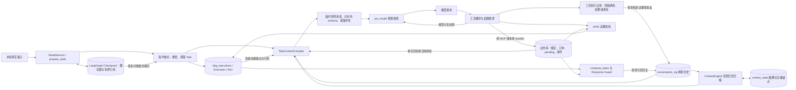

# OrderWeave 多 Agent 上下文工程实施方案

**人工审查稿 · 2026-11-20**。实施入口是按节点执行的零售 DAG。优先改三处边界：领取 Task 之前解析指代、调用角色模型之前编译最小可见视图、执行工具时留下可恢复的原始记录。沿用当前计划、调度器、业务事务和确定性收口。本文中的新接口、测试名、开关和阈值均为实施建议。

## 1. 版本、范围与基线

仓库 `soulbooyy/OrderWeave`，分支 `codex/retail-routing-ablation`，审查提交 **`5b6c7cc74c241dd275e5b1474669d45b2c4988e4`**。审查开始时工作区干净。通过 `git ls-remote` 核对，远端同名分支及 `main` 在审查时均指向该提交。

审查覆盖下表中的生产入口，以及 [DAG 需求](DAG-REQUIREMENTS.zh-CN.md)、[DAG 路线图](DAG-ROADMAP.zh-CN.md)、中英文 README、`evaluation/README.md`、`evaluation/RESULTS.md` 和现有规划、调度、MCP、权限、上下文及评测测试。早期路线图记录的是不同提交和实验角色配置。当前 `core/retail_subtasks.py::DEFAULT_RETAIL_ROUTING_MODE` 为 `dag`，默认 `order_lookup` 属 General，`billing_lookup` 属 Billing；`product_info` 属 Technical。Escalation 有独立的人工交接路径，规划 schema 没有 escalation 或 compose 节点。

**本次实测**使用 Python 3.12.13、现有虚拟环境、离线模型和测试临时库。运行了既有测试，没有运行付费评测或新增测试。以下两条命令分别得到 **144 passed** 和 **368 passed, 1 skipped, 1 warning**。跳过项是 Windows 内存接口，警告来自 Starlette 的 AnyIO 弃用接口。本机具备相关零售种子；在缺种子的环境应报告跳过或缺件，不能算作通过。

```sh
PYTHONDONTWRITEBYTECODE=1 .venv/bin/python -m pytest -q -p no:cacheprovider tests/test_context_engine.py tests/test_retail_dag.py tests/test_retail_dag_scheduler.py tests/test_dag_mcp_handoff.py tests/test_retail_role_permissions.py tests/test_dag_planning_v2.py
PYTHONDONTWRITEBYTECODE=1 .venv/bin/python -m pytest -q -rs -p no:cacheprovider tests
```

## 2. 当前请求怎样走到业务结果

| 环节 | 实际文件与方法（仓库根目录相对路径） | 数据、分支和落点 |
|---|---|---|
| 用户进入会话 | `api/main.py::chat` → `agents/retail_agent.py::RetailService.handle_turn` → `agents/retail_workflow.py::RetailWorkflow.handle_turn/_prepare_state` | 服务按 client/conv 加进程内锁。LangGraph 用业务库路径及 client/conv 派生 thread_id。正常新输入进 prepare_state，等待点用真实新消息 resume，悬挂执行可能直接进 recover_result。legacy 后端直接调用服务的准备、执行、收口。 |
| 本轮快照 | `RetailService._prepare_turn`、`_judge_confirmations/_update_facts/_update_plan` | 取 first_event_id，`RetailStore.begin_turn` 推进 sessions.turn_count，读绑定、pending、可见历史，可选并行判确认、抽取事实、刷新诉求。compiled 模式调用 `ContextEngine.prepare/user_blocks`，组装状态块和用户原话，挂接 context_view、transcript、spans。状态块可能有 bound_user_id、pending、recent_events、support、memory 等私有字段。 |
| 识别、规划 | `AgentOrchestrator.prepare_route(schedule=True)`、`core/intent_recognizer.py::IntentRecognizer.recognize/_llm_recognize`、`core/retail_subtasks.py::extraction_instruction`、`core/dag_planning.py::output_instruction/parse_plan/compile_nodes`、`core/dag_schema.py::DagResponse` | 先尝试 `DagRunner.resume`。pending、人工、支持流和澄清各有分支。DAG 分类 Prompt 带 JSON Schema/例子；服务端严格解析完整 JSON，拒绝重复键，Pydantic 按 kind 限制 output，语义校验原话、目标、依赖、条件。校验错最多一次纠正，记录 plan_status/attempts。合法计划经 `Plan.for_execution` 创建；失败可在分派前直接请求澄清。 |
| 分派 | `core/retail_subtasks.py::_ordered_tasks/OWNERS`、`core/retail_dag.py::Plan/Node/Condition/Run`、`core/retail_scheduler.py::Execution.next_node/target/inputs`、`agents/retail_dag_runner.py::DagRunner.next_role/save` | 拓扑序、单 running、成功前驱、互补分支汇合与同轮领取限制均已实现。先检查输出契约、身份、目标选择及角色能力，再 `Run.claim` 并按 revision 保存。多次派给同角色仍是独立节点。后端分别由 `RetailWorkflow._select_role/_run_role/_handoff_role` 和 `AgentOrchestrator.run` 驱动同一 Runner。 |
| 构造 Agent 输入 | `agents/retail_dag_runner.py::DagRunner.execute` 与模块函数 `task_context`、`agents/retail_multi_agent.py::RetailRoleMixin._tools_for_request/_build_system_prompt`、`agents/agent_orchestrator.py::BaseAgent._initial_messages/_call_llm` | replace 出 scoped Request；assignment 含 id/kind/quote/output/target、`Execution.inputs(task)` 和对应 input_refs，写任务可有 operation。context_view 仅返回该 packet；history/context/entities 清空，retail_handoff 与 transcript 置空，spans 共享。工具仍持有真实 req.message、guard 和 dag_ticket。模型当前通常只见任务原句片段。 |
| 模型与工具 | `agents/agent_loop.py::_run_tool_loop`、`agents/retail_tools.py::ROLE_TOOLS/TASK_TOOLS/retail_tools`、`agents/retail_hooks.py::TaskPermissionHook.pre_tool` 等 | 从实际注册工具中取运行配置、角色、派发限制与 kind 交集。每次 create 前组 system/messages/tools、max_tokens 等并依次调用 pre_model。校验工具、目标、输入和业务 hooks 后才执行 handler。保留原始 trace、工具 ID、状态、失败原因；整批形成 assistant tool_use 和 user tool_result，若有 transcript 则追加一组。 |
| 两阶段写入 | `mcp_tools/retail_client.py::RetailMCPClient.call_tool`、`retail_protocol.py::build_context_meta/parse_context_meta`、`retail_server.py::_call_tool`、`retail_store.py::RetailStore.write_action/_prepare_action/_execute_action/_valid_dag_claim`（以上四个文件均在 mcp_tools） | DAG 写入携带服务端 ticket；MCP 核对会话、轮次、claim 和权限，事务内再次查绑定、订单归属和 pending。准备产生 op_id、规范参数与 display_text，并关联 dag_operations。后续真实用户确认同一已展示操作和参数才可提交，权威结果落操作记录和 retail_events。传输层不自动重试写。 |
| 回填结果 | `DagRunner._prepared/execute/wait`、`core/retail_dag_evidence.py::verify/_write_evidence`、`Run.move`、`Execution.record_attempts` | 当前 attempt 的实际成功 trace 才可供校验；读校验目标、绑定和输出字段，写还要核对 op_id、kind、canonical_args 和同会话事件。写准备转 waiting_user，状态未知转 blocked，失败可为 missing_evidence。成功保存 facts 及 tool:/knowledge:/event: refs。保存后再选节点。 |
| 收口、发布、持久化 | `DagRunner.finish` → `agents/retail_dag_composer.py::compose_tasks` → `RetailMultiAgent.finish_turn` → `RetailService._finish_turn` → `agents/retail_response_guard.py::constrain_response` | 按节点顺序取已核实输出，组装未核实项、待确认原卡和 dag_confirmation_basis/dag_post_write。守卫核对 traces、绑定、pending、当前/历史事件；随后检查原卡是否出现并 mark_pending_displayed，再写可见回复、整轮日志、估算校准等。公开 turn_status 与整图 success 分开。LangGraph `_update_result/_wait_user` 保存有界结果并按需 interrupt。 |
| 中断与旧模式 | `DagRunner.resume/reconcile`、`RetailWorkflow._recover_result`；`agents/retail_handoff.py::build_role_handoff/role_outcome/bounded_outcome` | DAG 恢复用运行状态、引用的操作和业务记录，已提交事件匹配后才补成功，无凭据则保持未知。未展示的旧准备须作废。旧角色流仍从最新业务状态生成 RoleHandoff，有界 previous_role.note 仅供参考。普通多角色汇总可走 ResponseComposer，与 DAG 固定收口是两条路径。 |

### 持久化字段与读取者

| 写入位置 | 实际字段 / 键 | 使用边界 |
|---|---|---|
| SQLite `conversation_log` | PK(client_user_id, conv_id, seq)，turn、role、kind、agent、content_json、created_at。现有 kind 为 user/tool_call/tool_result/assistant | `ContextEngine.log_rows` + `RetailStore.save_turn_messages` 在 compiled 的轮末事务中先删该轮、再按 max(seq) 编号写入；同轮条数可幂等，seq 不是永不变化的事件标识。user 内容可含旧主角色 turn_extra。 |
| SQLite `context_state` | 每 client/conv 一条 payload_json，含 elided_upto_turn、summary.{upto_turn,text}、chars_per_token、compactions | `ContextEngine.prepare/_render/_elide/calibrate` 管全局历史。默认预算 32000、保留最近两轮，先省略旧结果，再按需摘要；摘要失败可只留下省略。prepare 只估渲染历史；校准来自 spans 的 input/cache_read/cache_write。 |
| SQLite `dag_executions`、`dag_operations` | plan_id、client、conversation、revision、active、payload；payload 是 `Execution.dump/load` 的 v1 Plan、runs、attempts、selected、operation、stop、bound_user 等。后表以 (plan_id,task_id,turn) 绑定唯一 op_id | `save_dag` 用旧 revision 比较更新，`open_dags` 只查 active。ticket=(plan_id,task_id,revision,turn)。Run 含 task_id、role、turn、attempt、status、reason、facts、refs；waiting 的 choices 也是 facts，仅 succeeded 的输出可供下游。 |
| 业务 SQLite | sessions、users/orders/products、pending_actions、action_operations、retail_events、confirmation_decisions；兼容库中还建有 pending_returns/return_operations | 此处确定身份、归属、准备/展示轮、参数、提交事件；与 DAG 状态分事务，所以必须能事后对账。历史摘要、角色转述、工具日志、checkpoint 均不能提供交易授权。 |
| 服务侧辅助存储 | retail_dialogue.payload_json 保留最近两轮可见文本、可选 return_basis/catalog_steps 等；task_facts、request_plan、retail_support_state 各管自己的业务视图 | `RetailService._prepare_turn/_finish_turn` 读写；诉求清单与 DAG Plan 不同。可选 `memory/conversation_memory.py::MemoryManager.get_context/add_message/_compress_locked` 有 Redis 工作记忆、摘要和 Chroma 检索等既有路径；编译器不委托它做第二次全局历史压缩。 |
| 独立 LangGraph SQLite | `RetailGraphState` 的 plan_id、phase、current_input、turn、current_task、waiting_reason、pending_refs、node_path、result，兼容路径还有 role_queue/role_result/handoff | `AsyncSqliteSaver` 保存图位置和恢复输入；current_task 在现实现是 retail/return 等工作流标签，非可靠节点 ID。活的 Request、DagRunner 和响应在 `_call` ContextVar。Checkpoint 不保存完整 Execution。 |
| 运行时、观测与计费 | `agents/retail_runtime.py::_build_retail_runtime` 注入 compiled/window、legacy/langgraph 以及分阶段 client；`evaluation/retail_ledger.py::_BudgetedMessages.create/RetailLedger.reserve/settle_success` 记 stage、请求哈希、预留和 usage 等 | ledger 以 `evaluation/retail_budget.py::request_input_upper_tokens` 对全请求 UTF-8 字节加格式开销预留费用，并有请求数限制。spans、tool_traces、live events、可选调试 dump 用途各异，不能代替持久历史或业务回执。 |

## 3. 需要工程改动的边界

| 状态 | 证据与实施决定 |
|---|---|
| 已实现，复用并补验证 | Planner 契约、双后端共用 Execution、claim/CAS、条件求值、按直接前驱出参、任务工具交集和服务端两阶段提交均已有实现。保持 Run 为 Task 结果唯一来源，角色实例可复用，任务消息不可复用。 |
| 已实现，复用并补验证 | 固定 Composer、服务端确认卡、最终 Guard 和按事件恢复已存在。继续使用旧 RoleHandoff 与普通工作流；不新建 LLM Composer、结果表、Handoff 表或每角色摘要。 |
| 部分实现，历史和依赖需衔接 | `DagRunner.execute` 保留依赖隔离，却覆盖 service 的 context_view。`ContextEngine._render` 在工具不属于本角色时仍把调用参数和结果转为文本；`_elide` 保留 input；无字段来源标签的 summary 可含地址/支付方式。简单调用 engine.view 会跨越可见性边界。 |
| 部分实现，指代需要前置处理 | `compile_nodes` 要求显式 target 出现在本轮 quote，空 target 通常须有兼容直接前驱。`Execution.target` 与 `DagRunner.next_role` 在创建模型视图**之前**就可能拒绝或等待。只给模型补一句历史无法解决“刚才那个订单”。 |
| 部分实现，审计缺少持久归属 | `_run_tool_loop` 在整批结束后才能追加 transcript，`DagRunner.execute` 设为 None。正常完成仍有 traces/spans、Run 和业务事件，但 compiled 日志通常只剩用户块和最终回复；`RetailService._loaded_skills` 也依赖历史真实工具结果。`save_turn_messages` 的整轮替换会覆盖增量写。 |
| 需新增，单请求上下文上限 | `ContextEngine.prepare` 的历史估算、ledger 的费用预留均未对角色模型窗口执行“完整请求 + 输出预留”的适配。`_run_tool_loop` 的 messages 是浅拷贝，原地改嵌套块会污染原始记录。`_BudgetedMessages.create` 还可能在 hook 之后补 thinking 选项。 |
| 部分实现，异常收口有缺口 | `DagRunner.execute` 保存停止状态后重抛已有预算异常；`RetailMultiAgent.fail_turn` 同样向上传播。LangGraph 的 DAG 角色分支直接 await execute，不能假定会到 compose_roles。`_recover_result` 可直接构造 RetailTurnResult，跳过常规日志收口；它枚举 active DAG，已落 terminal 的执行可能不在其中。 |
| 部分实现，前缀稳定性随任务变化 | `RetailRoleMixin._compose_system_prompt` 有固定角色和政策，`_build_system_prompt` 又拼入本 Task 的工具名，`BaseAgent._build_system_prompt` 在配置了 skill manager 时可加动态 skills。工具 schema 依权限变化本身是必要差异。 |

**范围**包括上下文选择、协议配对、最小日志扩展、请求窗口保护、回复与恢复的一致性及评测。模型选型、技能政策内容、业务数据模型、外部记忆后端改造、重写 Planner/Scheduler、引入向量检索或额外 LLM 生成任务摘要均不在本轮范围。路由论文指标或旧路线图的通过数不作为上线门槛。

## 4. 目标架构与接口契约



图中临时视图只活在一次 Task attempt 内。工具原件写同一 conversation_log，业务状态由工具事务写入业务库；两者即使共享 SQLite 文件也不具有跨 MCP 调用的原子性。

### 4.1 一份轮次材料，多份任务视图

1. **轮次材料**。在 `_prepare_turn` 完成 `engine.prepare` 后一次读取历史行、压缩状态及边界（turn、历史高水位），保留真实输入与快照的结构化字段。当前轮增量工具记录从历史读取中排除；同轮信息只经显式依赖和当前 attempt 进入。每次派发重新核对绑定、目标及 pending，发生变化时废弃旧选择。缓存只限本轮、同会话；不把历史读写或摘要调用放进 Task 循环。
2. **接口**。建议 `TaskContextCompiler.compile(turn_source, execution, task, role, effective_tools) -> TaskView`。输入采用现有类型，effective_tools 直接来自该 scoped Request 的 `_tools_for_request`。TaskView 输出新建的有序 messages、块的来源/敏感级别/是否可省/引用及受保护分组；协议外元数据留 host。BaseAgent 继续生成实际 system 和工具 schema，通过现有 context_view 接入；同一次编译使用同一份工具快照。临时 Handoff 就是按 `Execution.inputs(task)` 和对应 `Run.refs` 生成的依赖区，无额外存储。
3. **保留字段**。直接前驱必须成功、有证据，只读 parent.output；把必要字段按 DAG 顺序连同 ref 交付。例：T1 Technical 查 variants，T2 Billing 查该订单 item_ids，T3 Technical 可得到声明的变体和商品编号交集以及来源；订单地址、付款流水和 T2 角色回复不可进入 T3。合法依赖可以跨角色传递合同指定的派生值，不能据此取得查订单工具或解引用整张订单。字段与任务用途不相容时在派发前阻塞并记录原因，禁止静默少传必需依赖。
4. **可见性逐层收窄**。先按 client/conv、当前绑定、实体与轮次选候选，再按 task.kind/output、直接依赖、角色和工具权限投影字段，最后按相关性和预算排序。允许同实体、同用途、有来源的近期用户片段和经核验的事实。私有任务只显示 identity_verified 及需要的对象，公开商品任务不携带私有 session 块。原始输入由宿主完整保留；对单一授权范围可逐字传入，多诉求含无关身份/地址等时只给本 Task 的逐字片段及必要共指上下文。确认工具始终读取完整原始 req.message。快照逐字段新建，禁止直接复制 `user_blocks` 的状态 JSON、未过滤的 memory/turn_extra、旧 assistant 文本或手工拼接的历史 tool JSON。
5. **摘要和配对**。全局摘要仍用 context_state 的原锚点。旧自由文本无字段来源，不能靠关键词遮罩后整体下发。只从中提取与已准入目标和历史原句可交叉核对的有限候选，如同一商品的用户偏好；无法证明来源就省略或澄清。可选的近期原生交换必须完整匹配同轮、同 attempt、同批全部 ID，且所有字段均可见；否则按允许的单个事实生成有来源的文本或丢弃整组。复用 `core/context_engine.py::_merge` 合并相邻同角色消息的语义，在字段投影后渲染，不沿用未授权工具的全文本回退。
6. **缓存**。同一模型/语言/角色/政策版本/实际工具签名下，固定 system、schema 的枚举和序列化顺序，再放获准的稳定摘要片段和按时间排列的历史。用户原句、当前状态、动态 skills 提示、Task、依赖和操作放末尾；固定的系统级技能规则仍留 system。缓存分组按真实权限分开；不填充其他角色 schema。测试比较实际发送数据的稳定前缀字节与各组 schema 哈希；压缩锚点、许可或政策变化应使相应前缀失效。
7. **指代接口必须早于 next_role**。建议由同一模块的纯函数选择 `唯一已核对候选 / 需用户选择 / 无可用依据`。从同会话近期真实用户提及及已核实的实体取候选；私单重查现绑定和归属，颜色只作偏好，结合目标商品核验可用变体，新表述优先。“刚才那个订单”有两张符合条件的订单时只询问可披露的候选；换绑后旧私有候选失效。“换成之前说的颜色”可以恢复用户选项，写操作仍重新准备并展示。
8. **与规划契约对接**。保留 quote 原文和显式 target 必须在 quote 中的验证。对支持的显式指代，先生成宿主侧有来源的候选，规划器只描述当前动作、保留空 target。仅为已识别指代、kind/实体类型匹配的节点给 `parse_plan/compile_nodes` 传单独的解析上下文，允许空 target 进入既有 `Execution.selected` / choose_target 流程。初始化选定值或有界候选后再领取；多候选以服务器列表核验用户选择，零候选请求明确 ID。候选仍须按 kind 规定的实体类型核对；用户回复明确编号时重新查本人归属，不能仅靠编号格式或历史候选列表。不得伪造用户 quote、把模型补写的 ID 当 literal、替无依赖节点传递其他节点的结果，或放宽一般 unbound_target。缓存规划结果时把解析上下文的作用域/指纹纳入键，或绕过这类结果缓存；恢复时重验候选。未启用此能力时保持原校验和澄清。

### 4.2 同一日志的两步接入

**最小方案 M。** 共享请求级原始交换收集器，DAG 的每批记录由已领取 Run 加上 plan_id、task_id、attempt、turn、agent、批次序号和每个 tool_use_id。只保存工具块、原始参数/返回及执行状态；剥离混在 assistant 工具块旁的未发布草稿。宿主单独复制模型可见结果；verify、Guard、技能读取和日志继续使用原件。轮末仍可整批写，改动小，进程在收口前消失会丢失内存记录。M 只作为开发里程碑。对比基线时至少测每轮事务数、追加耗时、峰值内存和崩溃后缺失的交换数。

**增强方案 J（正式验收）**。在同一 conversation_log 内按批次增量写。建议用新增 kind `dag_exchange_v1` 和带版本的 content_json 信封，沿用现有列及事务，避免新建表或改变旧客户端按列数 INSERT 的假设。信封使用列表包一条结构化记录，解析器显式识别版本。逻辑键为 (client,conv,turn,plan_id,task_id,attempt,batch_no)，其内每个调用由 tool_use_id 及位置标识；同一次调用已有相同结果则空操作，重复 ID、同键不同参数或不同结果则记冲突并停止自动合并。禁止把尝试号、trace.id 或 request_id 单独用作去重键。

- 已领取 Task、即将执行第一项工具前，在短 `BEGIN IMMEDIATE` 中确保本轮真实用户行存在，登记本批拟调用列表并分配 seq；参数摘要用于判等，完整事实保存在本记录。每个 handler 进入前记该项 started，返回/拒绝/跳过后记录原始结果及对应状态。纯只读批次可合并写事务，但需在测试中明确中间缺口。事务内检查会话、领取身份和 run.attempt，工具执行及网络等待在事务外。旧 ticket 的迟到回包可挂回原尝试供审计，不能推进新 Run。
- 终态区分已返回、被拒/未执行、可能已执行但结果未知。工具抛错产生的协议错误块不等价于业务失败。崩溃可发生在“started → 调用”“业务提交 → 宿主收到结果”“单项完成 → 整批完成”之间。已有匹配业务事件可登记 reconciled 及 event ref；未收到原始回包即保持 raw_result 缺失。缺原件的批次不渲染为原生成功往返；可生成受限的核实说明。只读调用也不能事后虚构原结果。
- 读接口提供两个投影：审计按 turn/批次/调用位置读所有状态，模型仅渲染有权限且完整的批次，先按 tool_use_id 一对一验证；摘要器只消费已关闭轮的可摘要事实。恢复不重放未完成批次来凑齐配对。恢复对账没有原始回包时，即使已有业务事件也不伪造 tool_result；审计层给每个已登记调用关联一个状态槽，模型层仅接受 ID 完整的真实协议对。成功批次存一份原件，投影成两条逻辑协议消息；普通 user/assistant 仍分别一条。不要把身份查找、交接等有状态工具混入可随意重查的只读名单。
- DAG 关闭轮次时幂等补 user/最终守卫回复，用首次受认可的发布结果判等；**不能调用旧的 DELETE 全轮再插入**。检测与已发布结果冲突须核对真实可见记录，避免改写过去。打开过 J 的轮即使切换开关、重启或缺内存 transcript，也走兼容收口。读顺序以 turn、该轮稳定顺序为准；晚到结果更新原批，不追加到新轮。未关闭轮有审计价值，不能被预加载器当成完整聊天历史。
- 审计新行不得使旧模式的 `_render` 文本回退或摘要器把私有原文送给其他角色。统一实现日志解码，分别投影给 compiler、旧视图、全局 compaction、`_loaded_skills` 等消费者。加载技能的历史依据只接受成功且名称匹配的 load_skill 交换，不能从用户文本或未知结果恢复。`_user_order_ids` 必须区分真实用户块和系统快照。旧行缺 Task 标签按 legacy/unattributed 读取，不能回填猜测的归属。强制回滚旧二进制前先排空打开的 J 轮，见第 6 节。

### 4.3 单次请求预算与停止语义

**判定接口**建议为 `AgentContextBudgetGuard.check(request, view_metadata, model_limits, mode) -> decision`。decision 含允许发送的请求副本、前后估算、输出预留、采取的步骤及停止原因。角色工具循环把它作为最后一个 `pre_model` hook；在组完实际 system、全部工具描述和 input_schema、历史及本轮完整 messages、角色/协议包装和其他参数后运行。对每个模型配置明确窗口 W、`max_tokens` 输出预留 O、协议/估算余量 M，要求 **输入计数 I + O + M ≤ W**。不得把 W 直接填写为历史预算 32000。按模型处理 thinking 额度与 max_tokens 的包含关系，避免漏算或双算。

- `ContextEngine.estimate_tokens` 与只读 chars_per_token 可用于监控/快速分段，不足以证明硬上限。优先经该模型验证的本地 tokenizer 及消息模板；无精确计数时只对满足适用条件的模型复用现有全请求保守上界（已含格式开销，不再重复加）。估算与硬判定分别记数。没有可信模型窗口/计数方法时只开放监控，要求执行硬限的路径显式停止。预算值达边界及仅差一个 token 都要测试。
- 模式建议 off → observe → enforce。observe 超限只记 would_stop/would_trim；enforce 未超限时透传原请求。超限先去非必要历史，再对已完成的只读检索按任务所需 evidence_id、命中项及允许字段投影，最后用受限引用替换大块旧只读结果。每步保留 ID、来源及省略标识，按实际重建后的请求重算。引用只能在同会话/允许目标内取回，缺 resolvable 引用则停，不用 hash 假装能重查。不得对结构化 JSON 做字符截断。
- 每次发送前检查 tool_use/tool_result ID 双射、角色/批次顺序、无孤块。当前待回传的整个必要往返、Task/target/output、必要依赖、身份依据、用户确认原话、展示参数、op_id、写入/未知状态、原始确认卡均受保护。当前刚返回的只读大包如属于仍需交给模型的未完成往返且无法安全投影，直接停止。只在新副本上改二级及更深的列表/字典；原始循环、trace、J、全局日志、cstate 和交给证据校验的对象不被改写。允许的压缩是局部确定性代码，新增模型调用数为零。
- **覆盖边界**。角色 hook 能剪裁有出处的块，却不经过 intent（含纠正）、confirm、extract、plan、compact、可选 memory/retrieval 和旧 composer 等调用。在运行时共用的 `_BudgetedMessages.create` 补齐 thinking 等选项后、消耗轮次配额及 reserve 前，对最终实际 kwargs 复用同一计数逻辑做只读终检；不接收 host 元数据到供应商 API。无 Task 元数据的阶段超限时不剪授权或协议，走该 stage 的受控停止/失败语义；可选摘要失败保留既有锚点。用各 stage 真实入口的 spy 覆盖直连测试 client 及生产包装；只对零售运行时的实际模型发送计数，embedding、确定性 Escalation 与 DAG Composer 无 messages.create。区分 hook 预检次数、最终检查次数和真正发出的调用数，一次发送只算一笔成本。
- **错误传递**。局部窗口不足采用专门的 context_limit 原因，携带已完成的 traces/refs、最后安全工具边界，穿过 LoopError/AgentCallError 与默认 fallback 分支；在 DAG 宿主收敛。首次调用被挡且工具未进，可明确未执行；已有 confirmed prepare 或 commit 先核业务状态，缺证据且可能写入才设 unknown_result。保留原 BudgetExceeded/TurnRequestLimitExceeded 的上层硬停止与评测可见性；如需附受控结果，在服务边界先只读收口、再附到原异常或交给现有 API 映射，绝不因收口再次请求模型。禁止把费用拒绝改记成正常完成。

## 5. 按阶段实施

顺序为 **0 → 1 → 2（M → J）→ 3（监控 → 执行）→ 4 → 5**。每阶段使用一个独立实现提交，运行该阶段测试及前序回归；未过门槛就停在该阶段。下列新增文件/测试路径仅在相应阶段获准后创建。各阶段的“保留”指复用原契约，修改范围仅限“改动”列。

### Phase 0　冻结入口、权威状态与测试基线

- **目标与证据**：为两种 workflow、已验证依赖、显示确认、读写恢复和历史压缩建立可重放样本。现有 `test_repeated_specialist_through_service` 检查角色顺序，但替换了 actor.handle；`test_history_is_append_only_prefix` 测 engine 视图，两者均不能证明线上 DAG 模型收到历史。
- **涉及文件**：新增 `tests/test_dag_context_baseline.py`；改动仅限确有必要共享的离线夹具；保留 production、现有 DAG/权限/上下文/账本测试及本节的基线记录。
- **设计与步骤**：① 冻结实际 seed 哈希（既有 DAG 题集要求 SHA-256 为 `413a65160adbdb5fde0ffc0015c49b6d70250b10c18128de169b597af7766765`）、Plan、turn 消息、语言、owner、工具集合及两种 workflow；② 用脚本模型记录实际 create 入参，工具用临时 SQLite，同一次测试重启用同一业务库/独立 checkpoint；③ 导出脱敏断言（role、task、refs、事件数、日志 kind、checkpoint 字段），不用全量 prompt 快照；④ 运行定向及全套测试，区分平台跳过和缺资产。
- **Red / Green / Refactor**：先对 capture 夹具断言能捕获每次请求、检查库中 claim revision 与确认事件；夹具未接入时应红。已有特征用例包括 `test_ready_loop_repeated_role_fan_in_and_independent_failure`、`test_durable_claim_compare_and_swap`、`test_real_mcp_return_confirms_once_after_restarting_service`、`test_compaction_is_persisted_and_stable`。Green 要使观测夹具经过实际模型入口；将 DAG 不注入历史、日志缺工具、超窗未挡等现状登记为已知差距，以后各期新增反向断言，不将它们计为回归。Refactor 只提取重复的临时 store/spy 初始化。
- **验收**：T1→T2→T3 严格 Technical→Billing→Technical，T3 读对实体和直接依赖；重复 claim 失败且无业务变更；准备轮事件提交数 0，重启后真实确认同 op_id 提交数 1，再确认仍为 1；已压缩锚点复读一致；checkpoint 无整图/工具 JSON；第 1 节的既有基线无新增失败。
- **命令**：第 1 节两条命令，加 `.venv/bin/python -m pytest -q tests/test_dag_context_baseline.py`。
- **风险 / 回退 / 交付**：仅 mock 角色会遗漏真正序列化或 MCP 错误，至少保留一条 stdio MCP 重启用例。回退测试提交即可；交付冻结夹具、按版本记录的测试结果及已知缺口清单。

#### Phase 0 验收记录 · 2026-11-20

生产代码基线为 `5b6c7cc`，实施起点为 `b202541a`，Python 3.12.13。新增 [离线基线测试](../tests/test_dag_context_baseline.py) 使用上述冻结种子，由 RetailStore 校验 SHA-256。角色用实际零售类和本地 SQLite 工具，脚本模型从实际发送的消息中读取 assignment；捕获请求仅用于内存断言。既有 stdio MCP 测试独立覆盖真实协议传输和重启确认。

| 检查 | 实测结果 |
|---|---|
| 双后端请求与 DAG 持久化 | legacy 和 LangGraph 各发送 7 次模型请求（规划 1 次，三个 Task 各 2 次）。实际领取顺序为 Technical → Billing → Technical，领取时持久 Run 均为 running、attempt=1、revision 递增。T3 收到两个声明前驱的字段与 tool refs，从交集中选中商品 2652637226，验证结果为绿色。 |
| 历史与 Checkpoint | LangGraph 各节点的已保存状态可追踪同一计划，已检查中间状态和最终状态均无完整 DAG 或原生工具块。另用新 Store 与 ContextEngine 重开同一业务库，重复准备同一轮后摘要锚点仍为第 1 轮，只调用过一次摘要函数，原日志及历史视图一致。 |
| 确认、幂等与领取冲突 | 既有 stdio MCP 用例验证展示轮提交 0 次，重启后真实确认仅提交原 op_id 一次。双后端服务用例再确认后事件仍为 1；CAS 竞争仅一次成功，旧 ticket 准备操作被拒绝。 |
| 已知缺口 | 本轮模型调用看不到已写入上一轮日志的用户标记；三个工具各有真实往返与 Run 引用，但本轮 conversation_log 的 kind 只有 user、assistant。这两项实测分别供 Phase 1、2 对照。完整请求缺少模型窗口硬限制属于代码审查发现，Phase 0 未测真实模型超窗行为。 |

运行本节列出的三条 pytest 命令：既有定向组 **144 passed**，新增基线 **3 passed**，全套 **371 passed, 1 skipped, 1 warning**。跳过项为 Windows 专用内存接口，警告为既有 AnyIO 弃用提示。上述结果来自离线测试，不包含付费模型评测。

### Phase 1　按 Task 编译可见上下文

- **目标与证据**：让有权访问的上一轮信息和当前直接依赖一起到达各自的模型输入。`DagRunner.execute` 的局部 view 已有良好的隔离起点；`ContextEngine._render` 的全文本回退和 `compile_nodes` 的 unbound_target 是两处必须分别处理的限制。
- **涉及文件**：新增 `core/task_context.py`、`tests/test_dag_task_context.py`。改动 `agents/retail_agent.py`、`agents/retail_dag_runner.py`、`agents/agent_orchestrator.py`、`agents/retail_multi_agent.py`、`agents/retail_runtime.py`、`core/context_engine.py`；仅对第 4.1 节的受控空目标分支调整 `core/dag_planning.py`、`core/intent_recognizer.py`。保留 schema 的模型输出、业务权限、Run、两阶段写入及原 RoleHandoff。
- **设计与步骤**：① 引入仅 DAG+compiled 启用的编译开关，保留原 scoped view 为对照；② 服务传入一次性轮次材料，提取允许字段和摘要来源，先实现显式目标及直接依赖；③ 接入宿主指代选择与执行前复核，处理 quote、cache key、choose_target 及 resume；④ 拆固定与动态 Prompt，检查最终 create 的 schema 与工具执行白名单一致；⑤ 双后端共用 runner，window、single、keyword、subintent 继续原路径。本阶段持久化仍用现有 selected/runs/cstate。
- **Red / Green / Refactor**：先写两轮“刚才那个订单”、旧颜色后改口、换绑和两单歧义；同一 Technical 先后两次夹一 Billing，在无关分支、摘要、状态块、只读结果和旧 assistant 段各放不同私有哨兵。基线应在历史可用性或目标解析断言处红。Green 要在实际 provider spy 看到正确逐字片段、必要前驱及引用，非依赖哨兵零出现。Refactor 复用已有排序、字段契约、合并逻辑，避免每 Task 重新扫描全库或调用摘要模型。
- **验收**：两种 workflow 的唯一候选读取正确，歧义/过期候选触发澄清且写工具调用 0；确认仍基于真实 req.message；所有必需依赖字段及 refs 精确等于许可集合；同角色无跨 attempt 消息，schema 不超出交集。相同权限和锚点连续编译的稳定前缀逐字节相同，发布前旧业务/权限基线全绿。计数器证明每轮仅一次历史材料装载，编译/消歧产生的额外 LLM 调用为 0。
- **命令**：`.venv/bin/python -m pytest -q tests/test_dag_task_context.py tests/test_dag_planning_v2.py tests/test_retail_role_permissions.py tests/test_context_engine.py tests/test_retail_dag_scheduler.py`。
- **风险 / 回退 / 交付**：笼统摘要、整段用户原话和仅按工具名筛选都可能泄露其他节点信息。关闭新编译器及指代扩展；已有 v1 计划的 selected 继续按绑定核验，无法安全继续就等待明确目标。交付编译接口、字段许可表、输入快照断言及前缀对照。

#### Phase 1 验收记录 · 2026-11-20

实施起点为 `d224e96`。零售运行时通过 `RETAIL_TASK_CONTEXT_ENABLED=1` 显式启用编译器，生效条件为多角色 DAG 与 compiled 上下文。开关默认关闭。会话日志按轮读取，Task 单独编译；来源轮次、日志序号和宿主选择可追溯到用户消息。来源窗口沿用 ContextEngine 的 `keep_recent_turns`，默认两轮。更早的颜色偏好需要原句和已压缩摘要中的同一实体、同一颜色相互印证。

| 实际模型入口与业务库检查 | 离线结果 |
|---|---|
| 两个工作流的订单选择 | 唯一本人订单在领取前解析。遇到两笔、过期、其他绑定或他人订单时先询问，领取次数为 0。恢复时核对用户回复的编号与当前归属。 |
| 四任务请求的字段与来源 | 各后端均读取一次会话日志，规划 1 次，角色请求 8 次（每个节点一次工具往返）。Technical 收到已验证的 variants、交集中的 item_ids 和两个前驱的 refs。扫描 Technical 的所有实际请求，另一订单摘要、旧快照、Billing 支付信息、非依赖任务与旧助手回复五类标记均出现 0 次；两次 Technical 的 system 与工具 schema 序列化一致。 |
| 颜色改口、写入与回退 | 当前明确的新变体优先。历史颜色需能核对到所购商品及可用变体；来源不清时要求重新说明。测试中展示确认卡时提交事件为 0，重启服务并收到真实确认后，同一操作提交 1 次。隐式目标过期后旧卡失效；关闭开关后可继续核验挂起选择的明确编号。 |

[Phase 1 专项测试](../tests/test_dag_task_context.py) 覆盖以上行为。定向回归通过 134 项，全套离线回归通过 401 项，跳过 1 项 Windows 专用内存接口测试，另有 1 条既有 AnyIO 弃用警告。本阶段使用脚本模型和临时 SQLite，真实模型的成功率、时延与缓存命中率仍待评测。

### Phase 2　持久化有归属、可对账的工具往返

- **目标与证据**：从 `_run_tool_loop` 的真实调用位置采集工具事实，修复 `transcript=None` 与 `save_turn_messages` 整轮覆盖；支持在模型第二次调用前或用户尚未收到最终回复时崩溃。DAG Task 状态仍只由 Run/verify 更新。
- **涉及文件**：新增 `tests/test_dag_tool_log.py`；改动 `agents/agent_loop.py`、`agents/retail_dag_runner.py`、`agents/retail_agent.py`、`core/context_engine.py`、`core/task_context.py`、`mcp_tools/retail_store.py`、`agents/retail_runtime.py`；保留 scheduler、旧日志行格式、业务操作和 ledger 表。
- **设计与步骤**：① 实现第 4.2 节 M，给 collector 附上已领取 attempt 对应的批次身份，raw 与模型块脱离对象引用；② 先上线双格式 reader 和权限投影，再加 J writer，短事务里按逻辑键分配/更新 seq；③ 在 handler 前后和异常/拒绝路径记状态，补同轮 user/assistant 的幂等关闭；④ 给未关闭轮做只读对账，测试真实进程中断和两个独立 SQLite 连接竞争；⑤ 独立启用 J 后才认为完成。新格式限 DAG+compiled，旧模式读混合会话时也必须遵守新行的可见性。
- **Red / Green / Refactor**：先以三节点分别发起工具调用，包括多 tool_use、拒绝与重复 tool ID（不同 attempt）；在首个结果后、批次中途、业务提交后回包前、落日志后关闭前注入故障，再重启并尝试两次收口。现状会缺记录或被旧快照覆盖。已有 `test_loop_hooks_block_and_trace` 与 MCP ticket 用例是特征测试。Green 要区分已执行、确定未执行与未知；Refactor 将原件→审计和原件→模型两个投影集中到共享解码器。
- **验收**：审计可还原 T1/T2/T3 的顺序及 plan/task/attempt/tool_use_id；每个完整批次内 calls/results 的 ID 集和基数相等；同键同内容写两次、跨连接并发关闭两次后行数、顺序和内容不变，同键冲突显式报错。每个崩溃点都有已完成原件或明确未决项，对账成功关联既有 event，无法核验保持 unknown；实际业务事件数量不增加。虚构成功 0，半批原生渲染 0，临时 Prompt 落库 0。旧记录仍能渲染，旧流程不能读取 DAG 新行里的私有哨兵。
- **命令**：`.venv/bin/python -m pytest -q tests/test_dag_tool_log.py tests/test_context_engine.py tests/test_dag_mcp_handoff.py tests/test_retail_role_permissions.py tests/test_retail_dag_scheduler.py`。
- **风险 / 回退 / 交付**：事务变多、迟到回包、数据库繁忙、原始读单含私有数据。记录每批事务数、锁等待、日志字节数，不把正文输出到常规 telemetry。关闭新轮 J 写入，存量轮由兼容 writer 收口，保留双格式 reader。交付 M/J 结果对照、故障矩阵、兼容读写及锁等待报告。

### Phase 3　单请求预算监控与安全裁剪

- **目标与证据**：验证每次实际 create 的完整请求，包括循环首次、工具返回后及草稿修订。复用 `LoopHook.pre_model`、`request_input_upper_tokens`、`RetailLedger.reserve` 及供应商 usage，各自保持原有职责。
- **涉及文件**：新增 `core/agent_context_budget.py`、`tests/test_agent_context_budget.py`；改动 `agents/agent_loop.py`、`agents/retail_hooks.py`、`agents/agent_orchestrator.py`、`agents/retail_dag_runner.py`、`agents/retail_runtime.py`、`evaluation/retail_ledger.py`；保留 `evaluation/retail_budget.py` 费用语义及 `ContextEngine.prepare` 全局锚点。对实际吞掉新停止异常的 stage 调用点逐个补明确的停止映射。
- **设计与步骤**：① 建立按模型版本冻结的窗口/计数/余量配置和第 4.3 节的 decision；② 先 observe，从请求和 ledger 比对估算与实测偏差（含中文、大 schema 和多块 JSON）；③ 接入 TaskView 块元数据，做 copy-on-write 裁剪与完整协议校验；④ 在最终 transport 包装做终检，显式区分时间、费用、请求数与窗口拒绝；⑤ 强制模式仅在原始 evidence 已保全后开启，先离线后小流量。
- **Red / Green / Refactor**：先写刚好满窗、差 1 token、工具 schema 单独导致超限、返回后超限、非必要检索和必需写参数超长等测试。spy 记录真正的发送次数；夹具比较输入对象深拷贝、J 原件、cstate、Run 验证结果。已有 `test_publish_check_revises_once` 和 `tests/test_json_stage_budgets.py` 覆盖相关调用语义。Green 要使二次检查可观察，裁剪只发生在允许字段。Refactor 共用计数函数，保留各阶段原异常契约。
- **验收**：每个实际发送都通过终检且 enforce 时满足 I+O+M≤W；observe 不改输入，低于上限的输入结构完全相同。可省历史→只读投影→有界引用的顺序可断言。必须保留的当前往返不拆分、多工具 ID 对应合法，证据、授权、op_id、Task、目标和输出契约都完整。无安全解时发送数 0（该次）、新增业务写 0，不默认请求 LLM 摘要；清理后全局历史和锚点哈希不变。每请求有 stage、估算前后值、W/O/M、动作、停止原因及可用 usage，不记原始内容。
- **命令**：`.venv/bin/python -m pytest -q tests/test_agent_context_budget.py tests/test_json_stage_budgets.py tests/test_retail_ledger.py tests/test_dag_tool_log.py tests/test_context_engine.py tests/test_retail_dag_scheduler.py`。
- **风险 / 回退 / 交付**：估算偏小导致供应商拒绝，字节上界过宽导致误停，返回后的异常可能吞掉 partial traces。保留已完成原件和受控停止；enforce 可退回 observe/off，现有硬费用和业务守卫继续生效。交付预算检查、计数误差分布、裁剪优先级与跨 stage 覆盖表。

### Phase 4　统一收口、恢复及跨轮一致性

- **目标与证据**：贯通 `DagRunner.finish/reconcile`、`RetailWorkflow._compose_roles/_recover_result` 与 `RetailService._finish_turn`。已有 `compose_tasks` 只汇总声明输出，`constrain_response` 已能核对确认详情和事件；缺口在停止/恢复路径，以及发布、日志和 checkpoint 分开落盘。
- **涉及文件**：新增 `tests/test_dag_context_recovery.py`；改动 `agents/retail_dag_runner.py`、`agents/retail_workflow.py`、`agents/retail_agent.py`、`agents/retail_multi_agent.py`、`agents/agent_orchestrator.py`、`mcp_tools/retail_store.py`；保留 `agents/retail_dag_composer.py`、`agents/retail_response_guard.py` 的收口权威和旧 RoleHandoff。只有对应断言失败时才修正它们的具体输入/输出分支。
- **设计与步骤**：① 两后端所有 DAG 终点调用同一确定性“取状态→compose 或受控失败→guard→幂等记录”逻辑；无计划时返回澄清/错误；② 按精确 client/conv/plan_id/revision 重读，必要时增加含 inactive 的只读查询，拒绝跨会话或换绑；checkpoint 缺 plan_id 时只接续可唯一归属的旧执行；③ 用原业务记录区分准备、展示、确认、提交和未知；④ 已发布同一轮复用已守卫文本，复用/修复日志时不重跑 _prepare_turn、MemoryManager.add_message、模型、工具或 mark_pending_displayed；⑤ 再开始新的真实输入时按新 turn 处理。恢复轮/旧轮日志以原 turn 对账，不能用“继续”覆盖原始请求。
- **Red / Green / Refactor**：先从两个服务入口注入“已提交未 save_dag”“已 save_dag(active=0) 未 update_result”“已写最终日志未写 checkpoint”“已 prepare 未展示”“确认后模型预算停止”。已有 `test_recovery_uses_op_event_without_replaying_write`、`test_composer_orders_verified_basis_before_unmodified_card`、`test_composer_omits_unselected_branch_while_waiting_for_confirmation` 提供对照。Green 要用同一业务回执、一次发布标记、稳定的部分结果通过 Guard；Refactor 抽取只读收口/幂等发布函数，避免整个 _finish_turn 被重跑。
- **验收**：单节点额外 composer 模型调用 0；多 Task 回复包含每个适用的已证输出，失败/遗漏标未核实，条件假跳过不计遗漏。准备未执行，确认卡逐字符与业务库一致，真实确认前提交事件 0，提交后重启仍仅 1 个同参数事件；查不到回执时 blocked/unknown 且工具重放 0。预算停后仍给出可验证的部分结论及停止原因，全局硬停止信号可追踪。下一轮能看到上轮获准历史；同一 summary.upto_turn 成功后重复准备或恢复的新增摘要调用为 0。API turn_status、Task 状态、守卫结果、所记最终回复一致，旧 checkpoint 回放通过。
- **命令**：`.venv/bin/python -m pytest -q tests/test_dag_context_recovery.py tests/test_retail_dag_scheduler.py tests/test_retail_actions.py tests/test_retail_confirmation.py tests/test_dag_mcp_handoff.py tests/test_retail_role_permissions.py tests/test_web_console.py`。
- **风险 / 回退 / 交付**：checkpoint 可落后于业务提交，op 已 prepared 不代表用户看过，响应已送达客户端也不是数据库能独立证明的事实。维持现有“原卡进入最终回复且已记录 displayed”的保守边界；不清空 pending 或手工调低 revision。关闭新路径前排空或用兼容恢复器核实挂起计划。交付中断前后事件/引用/回复对账和两后端参数化测试。

### Phase 5　消融、性能验收与启用决定

- **目标与证据**：量化各项增量的功能、隐私、成本和延迟。`evaluation/harness/dag_ablation.py::evaluate/run_case/summarize` 已有脚本模型、真实服务、按题重置 SQLite、角色与证据评分；它比较 keyword/subintent/dag/frozen_dag，显式改写 order_lookup owner，构造的 RetailService 未注入 ContextEngine，脚本 Token 字段为 None。直接运行旧脚本不能回答本次问题。
- **涉及文件**：新增 `evaluation/harness/context_ablation.py`、`tests/test_context_ablation.py`；按需复用 `dag_cases.py/dag_alignment.py/dag_scoring.py`、`evaluation/retail_metrics.py`、`retail_ledger.py`，补 `evaluation/README.md` 的复现实验参数；保留旧实验入口、冻结 gold 和历史结果。
- **设计与步骤**：① 预注册第 7 节分母、成本上限、留出版本和启用门槛；② 四组统一实际 compiled 初始化、默认业务 owner、模型/权限/技能和业务种子，只有对应功能开关不同；③ 固定图+脚本验证执行，再以正常规划入口验证整链路；④ 分开报告离线、真实模型、冷/暖缓存和故障注入；⑤ 依据门槛记录启用/暂缓/退回 observe 的理由。
- **Red / Green / Refactor**：先给评分器喂入“条件假、漏办、待确认、重复读、重复写、直连未检查、无 usage、半批、未跑槽位”的标注记录，断言正确分母和失败原因；旧脚本不能产生四组或缓存数据，应红。Green 要使四组同题可逐条配对且没有假 Token；Refactor 抽取已有对齐/事件评分函数，避免靠模型自报成功。
- **验收**：四组完整逐题记录、配置/题目/种子哈希、预算账本、逐指标分子分母和第 7 节门槛全部可重算；固定图与正常入口结果分别呈现。若数据不完整或差异未达门槛，阶段交付结论为“暂缓默认启用”，不能用以宣称上线通过。
- **命令**：`.venv/bin/python -m pytest -q tests/test_context_ablation.py tests/test_dag_ablation.py tests/test_retail_metrics.py tests/test_retail_ledger.py` 和全套 pytest。拟新增的离线入口为 `.venv/bin/python -m evaluation.harness.context_ablation --arms A B C D --model offline --output /tmp/orderweave-context-ablation.json`，验收时必须从该命令的输出复算。付费组须在定版清单中显式传入模型版本、样本及总费用上限。
- **风险 / 回退 / 交付**：小样本缓存预热、不同模型快照、费用截断都会扭曲平均数。固定排序种子并轮转组序，保留未完成槽位。回退仅停新开关，保留可读的既有会话；交付逐题比较、汇总、资源成本、失败样例及发布决定。

## 6. 数据兼容、故障核对与回退

推荐首版**零 DDL，双格式读取，新增记录按功能开关写入**。新增日志信封使用既有 kind/content_json 承载，reader 先于 writer 部署。发现未知版本时保留原记录，停止该批的原生回放，产生可诊断原因。既有 `Execution.load` 只识别 Plan.version=1，不借本次重构改变 v1 节点格式。compile/observe/off 均不得重算已有 DAG、清空数据库或回退业务交易。

| 故障窗口 / 输入 | 先核对什么 | 恢复、用户可见结果与回退条件 |
|---|---|---|
| 旧会话只有 retail_dialogue，或旧 DAG 没有工具原件 | client/conv、bound_user、Run 证据、现存业务记录 | 只呈现可验证字段；无法解引用的历史 tool:id 只作来源标识。需要详情时走获准只读路径或澄清。不批量补造调用、不重做旧摘要。window 模式沿用可见窗口。 |
| 轮次并发、领取过期、身份变更 | checkpoint.thread_id、sessions.turn_count、绑定、plan_id/revision、run.turn/status | 冲突者重新加载并只读核对；CAS 失败不能继续持旧 ticket 执行。已改变身份不继承旧私有历史；有 pending 时沿用取消/重新准备策略。 |
| 日志已 started，业务回包缺失 | 按 plan/task/turn 查 dag_operations，再按本会话 op_id/kind/args 查 pending 或 executed event | 无发送凭据时不声称“未执行”；有已提交事件可补 Run 和引用，仍注明原工具响应缺失。不可核验则停 unknown。严禁通过再次写入验证结果。 |
| 已准备，显示前崩溃 / 用户改口或取消 | pending.status、prepared_turn、displayed_turn、display_text 与真实新消息 | 废弃未展示的过期详情；改参数、目标或取消须走现有状态变更。显示过的卡也只在后续轮确认同一操作时可提交。 |
| 业务已提交，Runner 或 checkpoint 尚未保存 | 匹配业务事件、操作、会话、目标、参数；按引用重读 active 或 terminal DAG | 仅补已核实成功；下游读节点按既有状态机重新判定。已有成功写入绝不重新调用。未知或多计划不能唯一归属则给受控核实说明。 |
| J 记录成功、重复收口、晚到回包 | 逻辑批次键、原始事实摘要、最终用户可见回复、turn 的关闭标记（最终 assistant 行） | 已关闭轮相同内容空操作；冲突留痕、人工核对或受控失败。不得用空 transcript 删除批次，不以历史校准/摘要代替回复补记。 |
| 裁剪或预算拒绝发生在查询/准备/提交之后 | 原件、共享 guard、Run 与业务事件 | 保留可证读结论；prepared 不称成功；executed 须有事件；未知保持阻塞。禁用跨角色重试或为了生成解释再开一次模型。 |
| 摘要失败、并发校准、SQLite 写锁 | `summary.upto_turn`、所用历史高水位、已有校准值和业务事务状态 | 只处理高于已确认锚点的完整轮；读旧值并在短事务合并单字段，锚点单调不回退。对 context_state 的整包覆盖不能丢失另一更新。对日志幂等写可有限重试，超出后安全停止并对账，不能重跑工具；不跨模型或 MCP 持锁。 |

**启停顺序**。开关区分原节点视图/任务编译、日志 off/M/J、请求预算 off/observe/enforce，保留原 workflow、routing、context_mode 的含义。逐项关回，先降 enforce，再停止新轮写入 J，保留读/修复能力，最后回原视图。阶段 4 的安全收口必须兼容所有组合。旧版本的 `save_turn_messages` 会 DELETE 同轮；混跑不同 writer 的同一会话不可安全回滚。先停止新领取、让已开始的轮完成或只读对账、确认未决轮和 pending，再切换二进制。已收口的新格式记录留在库内；旧客户端忽略的新种类可能降低历史可用性，不能用删除记录解决。若生产吞吐证明逐轮查询 JSON 不可承受，再独立评审可空元数据列/唯一索引和显式列名 INSERT 的迁移；不把迁移设成首版前置条件。

**数据暴露边界**。新增 DAG 原件进入本地会话日志后，读日志必须校验 client/conv，读取私有细节时复核绑定和角色用途。不同模式或身份之间复用同一会话，还需阻断旧全局 summary/旧 user 快照把新私有字段带回普通视图；不能判别来源时使用保守的字段投影。保持旧格式解码和业务行为，对不安全的展示另有泄露测试。常规指标仅记数值、技术标识和版本，外部 API 沿用有界 task_runs。现有 `agent_loop._dump_request` 可通过环境变量写全量请求，live_events 也可接收模型/工具正文；验收和上线默认关闭全请求落盘，测试用内存 spy，日志汇总不转储正文。

## 7. A/B/C/D 消融与发布判据

| 组别 | 执行配置 | 所回答的问题 |
|---|---|---|
| A | 审查 SHA 的 DAG 行为，compiled、原节点视图、轮末原日志、原费用保护 | 当前完整服务基线；用冻结提交交叉验证同一实现中关闭所有新增开关的结果。 |
| B | A + TaskContextCompiler 及受控指代解析 | 是否改进跨轮指代及依赖可用性，是否扩大数据可见性？ |
| C | B + 增量统一日志 J、相应双格式读取与对账 | 相比 B 可恢复多少工具事实，写锁和延迟代价多少？ |
| D | C + 完整请求 Guard enforce、对应的停止及恢复收口 | 大请求能否安全发送或停下，整体正确率、成本、缓存和恢复怎样变化？ |

四组安全校验、固定 Composer 与 Guard 一致。收口兼容修正若会单独影响 C/D，可在 C 上增加同一收口版本的诊断重跑，报告差异来源，不混入 A 的实测。先用脚本和冻结计划定位执行器差异，再用正常 `prepare_route` 跑用户输入以覆盖规划与指代。主实验使用代码默认 OWNERS；早期实验把 order_lookup 覆盖为 Billing，只能作为单列的角色配置复核。

**冻结清单**：提交与补丁哈希、模型供应商和不可变模型版本（若仅有别名，记录响应版本、时间并标明限制）、Prompt/工具 schema/政策/技能哈希、语言、temperature、thinking、max_tokens、窗口/估算器、开关、两种后端配置、MCP transport、请求上限、定价和计费方式；同一题相同真实用户脚本、gold、确认规则与故障点。用同一初始 SQLite 快照独立复制，每组独立 checkpoint、缓存/记忆命名空间和 ledger。不得让 A 的已确认交易污染 B。控制并发、机型、缓存预热、连接复用，轮转同题组次；供应商缓存不能强制清空时单列冷/暖和观测限制。脱敏报告保留每题每次运行粒度。

**真实模型试验建议值（尚未运行）**：预注册 12 个留出会话 × 2 次 × 4 组 = 96 个计划槽位。题型覆盖单节点、重复角色三节点、两种条件分支、歧义、历史颜色改口、换绑、长检索、确认/撤回、提交后中断；另用离线故障矩阵覆盖极端路径。建议初始总硬上限人民币 20 元（每组 5 元，单轮最多 32 次模型请求）；用已批准且可记录版本的同一零售模型与同一价格表。运行前在清单中锁定具体模型标识、日期、留出题哈希与预算，未锁定不启动付费组。预算耗尽保留未跑槽位，不能删题换分母或自动加钱。离线脚本不提供真实 usage、缓存或模型费用，标 NA，不填 0 token 或虚拟命中率。README 的 **86.5%** 是历史输入缓存指标，本次没有新测缓存读数。

| 指标 | 分子、分母与证据 |
|---|---|
| Task 分配正确率 / 依赖顺序正确率 | 按 kind/目标/输出语义对齐 gold，统计正确角色节点 / 应派适用节点；满足父成功后才执行的必需边 / 全部适用必需边。缺失节点的边不算正确；分开报告图结构正确率与实际执行先后。 |
| 同轮完成率 / 请求遗漏率 | 在 gold 指定轮由证据完成的节点 / 该轮应完成节点；未规划或既未办理也未明确交代的适用诉求 / 全部适用诉求。正确等待单列，false 分支排除，未判明分支不能冒充跳过。 |
| 端到端业务成功率 | 全部适用节点、最终回复守卫、预期订单状态/事件、确认时序与无多余写入均正确的会话 / 全部计划槽位。并列已执行分母、未完成/未跑数。 |
| 重复调用 / 未授权或重复写 | 同任务、规范参数、未变化权威状态下的不必要重复工具执行数 / 实际工具执行数；准备与次轮确认是两个合法阶段。重复/未授权**提交笔数**以权威事件和操作键计，拒绝尝试另计。 |
| 请求、输入、输出与缓存 | 每用户轮实际模型发送总数与分 stage 数（含纠正/摘要），每轮总输入为 ledger 归一化后的 input_main+cache_read+cache_write，另报 output。缓存读占比为总 cache_read / 有可比 usage 的总输入，报告供应商字段语义、缺失率和按权限签名分层结果。 |
| 延迟、成本、预算与日志代价 | 端到端每轮耗时（含读写、compaction、恢复）报 P50/P95；另报 compiler/guard/事务耗时、锁等待、每轮日志字节与事务数。模型费用用同口径 ledger 结算、CNY/轮和总额，标明估算/对账状态。would_trim、实际裁剪、超限拒绝分别按请求计，区分费用拒绝。 |
| 中断恢复正确率 | 每个预设断点最终 Run、真实业务状态、日志完备/显式未知、回复及零重放全部符合预期的会话 / 全部故障注入会话。另统计无归属记录数、配对错误数、非依赖哨兵泄露数。 |

**预注册上线门槛（建议，先冻结再看数据）**：

1. 安全与协议为硬门槛：所有离线关键路径通过；新增越权/重复提交、假确认、漏守卫、私有哨兵泄露、假成功原件、协议孤块、enforce 超限实际发送，均为 0。每个预设中断点恢复正确率 100%，真实模型发生任何此类事故即暂缓。
2. 配对比较 B/C/D 对 A。冻结脚本中原已通过的分配、依赖、同轮完成及业务结果不得退化；新增跨轮指代与长请求 fixture 各自达到规定的成功或受控停止，模糊目标准确澄清。真实留出按固定分母报逐题差、重复间波动与配对区间；建议 D 的端到端成功率、分配/依赖正确率不低于 A，遗漏率及无意义重复调用率不高于 A。小样本给出的相同点估计不等于证明等效。
3. 建议普通短轮 D 相对 A 的 P95 延迟增幅 ≤10%，每轮实际请求数不增加，长检索配对集 D 相对 C 的模型输入总量下降且必需事实无损。D 的每成功会话费用 ≤A 的 110%；成功数为 0 时不能判通过。缓存读占比按同组权限签名和冷热分层比较，以百分点报告差异；建议同质暖缓存组下降超过 5 个百分点时暂缓，先核前缀是否重排。比例分母为 0 或 usage 不足时标未验证。发布不得以扩大权限换取缓存提升。
4. 不完整、费用截断、锁等待超出服务延迟门槛或供应商版本漂移时保留 observe，列出未验证项。允许在独立新批次扩样，但先冻结新分母、预算和判据，保留原批次。

## 8. 最终验收清单

- [ ] 版本与配置可重建，两个 workflow 通过同一关键业务夹具，旧 single/keyword/subintent/window、RoleHandoff 与历史会话可继续工作。
- [x] 两次同角色 Task 的实际模型视图独立；跨轮原句、消歧、直接前驱和必要证据正确，其他节点/其他身份的私有字段不可见。
- [ ] 历史压缩仅由 ContextEngine 更新日志对应的全局锚点，无每 Agent 摘要、额外 TaskResult/Handoff 表或完整 Prompt checkpoint。
- [ ] 每个已完成交换归属唯一、原件可对账，异常批次明确未知，重复收口/恢复无重复记录；模型裁剪与原件哈希独立。
- [ ] 预算监控与强制模式均覆盖首次、工具后、修订及运行时其他实际模型调用；超限保留关键字段、协议、授权与输出空间，无法容纳时有受控结果。
- [ ] CAS、任务领取、绑定归属、两阶段写入、op_id/参数一致、真实确认、结果核验及幂等的负例全部通过。
- [ ] 单/多 Task、部分失败、条件跳过、等待、预算停止和中断恢复正确收口；原卡与最终可见回复可核对，仅凭自由文本的提交次数为 0。
- [ ] 四组消融可复算；离线与实测模型数据分列；各开关完成回退演练且未丢失历史或改变已提交业务。

## 9. 人工审查需要决定什么

| 决策 | 推荐与可验证的取舍 |
|---|---|
| 跨轮无字面目标如何处理 | 推荐仅为受控指代接受空 target，宿主核验后写入已有 selected；有多个候选就问。若坚持原解析器一律拒绝，此类新计划只能要求用户重述编号，应明确降低自动消歧验收范围。 |
| 日志持久性与存储成本 | 推荐 M 用于验证归属，J 用于正式启用；先复用同表版本化 JSON 和短事务。接受崩溃后标明原始回包缺失，并以业务事件核实写入。若要求每个 MCP 响应字节都能在崩溃后找回，则需生产者端持久回执协议，超出首版范围。确认原件的访问与保留期限后再部署。 |
| 窗口判定与停止契约 | 推荐按实际模型版本登记窗口和计数器，先观察；无可依赖的硬上界时不启用 enforce。局部不足由 DAG 明示并收口，已有全局费用/请求上限继续对 API/评测可见。 |
| 默认启用与真实模型费用 | Phase 0、1 已完成离线验收，其余按阶段门槛推进。付费试验前单独确认模型版本、96 个槽位、20 元总预算与第 7 节性能阈值。任一安全门槛失败即保留现有默认。 |

本次实施止于 Phase 1 的离线验收。下一阶段为 Phase 2，待人工批准。
