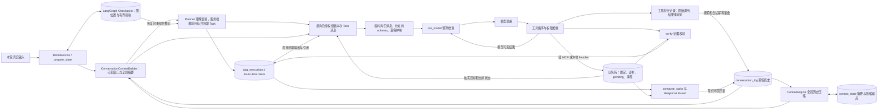

# OrderWeave 多 Agent 上下文工程实施方案

**人工审查稿 · 2026-11-20**。Phase 0 基线为 `d224e96`。新版 Phase 1 已在原分支 `codex/retail-routing-ablation` 固定为 `44828a3`，其 12 个文件与隔离工作树逐字节一致。Phase 2 在原工作区基于这一提交重新实施。Planner 通过近期对话和已有全局摘要理解改口与指代，服务端负责目标归属、工具权限和业务确认。第 2 节记录原审查基线，第 4 节给出接口，第 5 节区分已验证行为和后续计划。

## 1. 版本、范围与基线

仓库 `soulbooyy/OrderWeave`，分支 `codex/retail-routing-ablation`，审查提交 **`5b6c7cc74c241dd275e5b1474669d45b2c4988e4`**。本轮修订以文档提交 `b202541a` 为起点。原代码审查开始时工作区干净。通过 `git ls-remote` 核对，远端同名分支及 `main` 在审查时均指向该提交。

审查覆盖下表中的生产入口，以及 [DAG 需求](DAG-REQUIREMENTS.zh-CN.md)、[DAG 路线图](DAG-ROADMAP.zh-CN.md)、中英文 README、`evaluation/README.md`、`evaluation/RESULTS.md` 和现有规划、调度、MCP、权限、上下文及评测测试。早期路线图记录的是不同提交和实验角色配置。当前 `core/retail_subtasks.py::DEFAULT_RETAIL_ROUTING_MODE` 为 `dag`，默认 `order_lookup` 属 General，`billing_lookup` 属 Billing；`product_info` 属 Technical。Escalation 有独立的人工交接路径，规划 schema 没有 escalation 或 compose 节点。

**原代码审查时的离线基线**使用 Python 3.12.13、现有虚拟环境、离线模型和测试临时库。运行了既有测试，没有运行付费评测或新增测试。以下两条命令分别得到 **144 passed** 和 **368 passed, 1 skipped, 1 warning**。跳过项是 Windows 内存接口，警告来自 Starlette 的 AnyIO 弃用接口。本机具备相关零售种子；在缺种子的环境应报告跳过或缺件，不能算作通过。

```sh
PYTHONDONTWRITEBYTECODE=1 .venv/bin/python -m pytest -q -p no:cacheprovider tests/test_context_engine.py tests/test_retail_dag.py tests/test_retail_dag_scheduler.py tests/test_dag_mcp_handoff.py tests/test_retail_role_permissions.py tests/test_dag_planning_v2.py
PYTHONDONTWRITEBYTECODE=1 .venv/bin/python -m pytest -q -rs -p no:cacheprovider tests
```

## 2. 原审查基线的请求路径

| 环节 | 实际文件与方法（仓库根目录相对路径） | 数据、分支和落点 |
|---|---|---|
| 用户进入会话 | `api/main.py::chat` → `agents/retail_agent.py::RetailService.handle_turn` → `agents/retail_workflow.py::RetailWorkflow.handle_turn/_prepare_state` | 服务按 client/conv 加进程内锁。LangGraph 用业务库路径及 client/conv 派生 thread_id。正常新输入进 prepare_state，等待点用真实新消息 resume，悬挂执行可能直接进 recover_result。legacy 后端直接调用服务的准备、执行、收口。 |
| 本轮快照 | `RetailService._prepare_turn`、`_judge_confirmations/_update_facts/_update_plan` | 取 first_event_id，`RetailStore.begin_turn` 推进 sessions.turn_count，读绑定、pending、可见历史，可选并行判确认、抽取事实、刷新诉求。compiled 模式调用 `ContextEngine.prepare/user_blocks`，组装状态块和用户原话，挂接 context_view、transcript、spans。状态块可能有 bound_user_id、pending、recent_events、support、memory 等私有字段。 |
| 识别、规划 | `AgentOrchestrator.prepare_route(schedule=True)`、`core/intent_recognizer.py::IntentRecognizer.recognize/_llm_recognize`、`core/retail_subtasks.py::extraction_instruction`、`core/dag_planning.py::output_instruction/parse_plan/compile_nodes`、`core/dag_schema.py::DagResponse` | 先尝试 `DagRunner.resume`。pending、人工、支持流和澄清各有分支。DAG 分类 Prompt 带 JSON Schema/例子；服务端严格解析完整 JSON，拒绝重复键，Pydantic 按 kind 限制 output，语义校验原话、目标、依赖、条件。校验错最多一次纠正，记录 plan_status/attempts。合法计划经 `Plan.for_execution` 创建；失败可在分派前直接请求澄清。 |
| 分派 | `core/retail_subtasks.py::_ordered_tasks/OWNERS`、`core/retail_dag.py::Plan/Node/Condition/Run`、`core/retail_scheduler.py::Execution.next_node/target/inputs`、`agents/retail_dag_runner.py::DagRunner.next_role/save` | 拓扑序、单 running、成功前驱、互补分支汇合与同轮领取限制均已实现。先检查输出契约、身份、目标选择及角色能力，再 `Run.claim` 并按 revision 保存。多次派给同角色仍是独立节点。后端分别由 `RetailWorkflow._select_role/_run_role/_handoff_role` 和 `AgentOrchestrator.run` 驱动同一 Runner。 |
| 构造 Agent 输入 | `agents/retail_dag_runner.py::DagRunner.execute` 与模块函数 `task_context`、`agents/retail_multi_agent.py::RetailRoleMixin._tools_for_request/_build_system_prompt`、`agents/agent_orchestrator.py::BaseAgent._initial_messages/_call_llm` | replace 出 scoped Request；assignment 含 id/kind/quote/output/target、`Execution.inputs(task)` 和对应 input_refs，写任务可有 operation。context_view 仅返回该 packet；history/context/entities 清空，retail_handoff 与 transcript 置空，spans 共享。工具仍持有真实 req.message、guard 和 dag_ticket。模型当前通常只见任务原句片段。 |
| 模型与工具 | `agents/agent_loop.py::_run_tool_loop`、`agents/retail_tools.py::ROLE_TOOLS/TASK_TOOLS/retail_tools`、`agents/retail_hooks.py::TaskPermissionHook.pre_tool` 等 | 从实际注册工具中取运行配置、角色、派发限制与 kind 交集。每次 create 前组 system/messages/tools、max_tokens 等并依次调用 pre_model。校验工具、目标、输入和业务 hooks 后才执行 handler。保留原始 trace、工具 ID、状态、失败原因；整批形成 assistant tool_use 和 user tool_result，若有 transcript 则追加一组。 |
| 两阶段写入 | `mcp_tools/retail_client.py::RetailMCPClient.call_tool`、`retail_protocol.py::build_context_meta/parse_context_meta`、`retail_server.py::_call_tool`、`retail_store.py::RetailStore.write_action/_prepare_action/_execute_action/_valid_dag_claim`（以上四个文件均在 mcp_tools） | DAG 写入携带服务端 ticket；MCP 核对会话、轮次、claim 和权限，事务内再次查绑定、订单归属和 pending。准备产生 op_id、规范参数与 display_text，并关联 dag_operations。后续真实用户确认同一已展示操作和参数才可提交，权威结果落操作记录和 retail_events。传输层不自动重试写。 |
| 回填结果 | `DagRunner._prepared/execute/wait`、`core/retail_dag_evidence.py::verify/_write_evidence`、`Run.move`、`Execution.record_attempts` | 当前 attempt 的实际成功 trace 才可供校验；读校验目标、绑定和输出字段，写还要核对 op_id、kind、canonical_args 和同会话事件。写准备转 waiting_user，状态未知转 blocked，失败可为 missing_evidence。成功保存 facts 及 tool:/knowledge:/event: refs。保存后再选节点。 |
| 收口、发布、持久化 | `DagRunner.finish` → `agents/retail_dag_composer.py::compose_tasks` → `RetailMultiAgent.finish_turn` → `RetailService._finish_turn` → `agents/retail_response_guard.py::constrain_response` | 按节点顺序取已核实输出，组装未核实项、待确认原卡和 dag_confirmation_basis/dag_post_write。守卫核对 traces、绑定、pending、当前/历史事件；随后检查原卡是否出现并 mark_pending_displayed，再写可见回复、整轮日志、估算校准等。公开 turn_status 与整图 success 分开。LangGraph `_update_result/_wait_user` 保存有界结果并按需 interrupt。 |
| 中断与旧模式 | `DagRunner.resume/reconcile`、`RetailWorkflow._recover_result`；`agents/retail_handoff.py::build_role_handoff/role_outcome/bounded_outcome` | DAG 恢复用运行状态、引用的操作和业务记录，已提交事件匹配后才补成功，无凭据则保持未知。未展示的旧准备须作废。旧角色流仍从最新业务状态生成 RoleHandoff，有界 previous_role.note 仅供参考。普通多角色汇总可走 ResponseComposer，与 DAG 固定收口是两条路径。 |

### 持久化字段与读取者

| 写入位置 | 实际字段 / 键 | 使用边界 |
|---|---|---|
| SQLite `conversation_log` | PK(client_user_id, conv_id, seq)，turn、role、kind、agent、content_json、created_at。现有 kind 为 user/tool_call/tool_result/assistant | `ContextEngine.log_rows` + `RetailStore.save_turn_messages` 在 compiled 的轮末事务中先删该轮、再按 max(seq) 编号写入；同轮条数可幂等，seq 不是永不变化的事件标识。user 内容可含旧主角色 turn_extra。 |
| SQLite `context_state` | 每 client/conv 一条 payload_json，含 elided_upto_turn、summary.{upto_turn,text}、chars_per_token、compactions | `ContextEngine.prepare/_render/_elide/calibrate` 管全局历史。默认预算 32000、保留最近两轮，先省略旧结果，再按需摘要；摘要失败可只留下省略。prepare 只估渲染历史；校准来自 spans 的 input/cache_read/cache_write。 |
| SQLite `dag_executions`、`dag_operations` | plan_id、client、conversation、revision、active、payload；payload 是 `Execution.dump/load` 的 v1 Plan、runs、attempts、selected、operation、stop、bound_user 等。后表以 (plan_id,task_id,turn) 绑定唯一 op_id | `save_dag` 用旧 revision 比较更新，`open_dags` 只查 active。ticket=(plan_id,task_id,revision,turn)。Run 含 task_id、role、turn、attempt、status、reason、facts、refs；waiting 的 choices 也是 facts，仅 succeeded 的输出可供下游。 |
| 业务 SQLite | sessions、users/orders/products、pending_actions、action_operations、retail_events、confirmation_decisions；兼容库中还建有 pending_returns/return_operations | 此处确定身份、归属、准备/展示轮、参数、提交事件；与 DAG 状态分事务，所以必须能事后对账。历史摘要、角色转述、工具日志、checkpoint 均不能提供交易授权。 |
| 服务侧辅助存储 | retail_dialogue.payload_json 保留最近两轮可见文本、可选 return_basis/catalog_steps 等；task_facts、request_plan、retail_support_state 各管自己的业务视图 | `RetailService._prepare_turn/_finish_turn` 读写；诉求清单与 DAG Plan 不同。可选 `memory/conversation_memory.py::MemoryManager.get_context/add_message/_compress_locked` 有 Redis 工作记忆、摘要和 Chroma 检索等既有路径；编译器不委托它做第二次全局历史压缩。 |
| 独立 LangGraph SQLite | `RetailGraphState` 的 plan_id、phase、current_input、turn、current_task、waiting_reason、pending_refs、node_path、result，兼容路径还有 role_queue/role_result/handoff | `AsyncSqliteSaver` 保存图位置和恢复输入；current_task 在现实现是 retail/return 等工作流标签，非可靠节点 ID。活的 Request、DagRunner 和响应在 `_call` ContextVar。Checkpoint 不保存完整 Execution。 |
| 运行时、观测与计费 | `agents/retail_runtime.py::_build_retail_runtime` 注入 compiled/window、legacy/langgraph 以及分阶段 client；`evaluation/retail_ledger.py::_BudgetedMessages.create/RetailLedger.reserve/settle_success` 记 stage、请求哈希、预留和 usage 等 | ledger 以 `evaluation/retail_budget.py::request_input_upper_tokens` 对全请求 UTF-8 字节加格式开销预留费用，并有请求数限制。spans、tool_traces、live events、可选调试 dump 用途各异，不能代替持久历史或业务回执。 |

## 3. 需要工程改动的边界

| 状态 | 证据与实施决定 |
|---|---|
| 已实现，复用并补验证 | Planner 契约、双后端共用 Execution、claim/CAS、条件求值、按直接前驱出参、任务工具交集和服务端两阶段提交均已有实现。保持 Run 为 Task 结果唯一来源，角色实例可复用，任务消息不可复用。 |
| 已实现，复用并补验证 | 固定 Composer、服务端确认卡、最终 Guard 和按事件恢复已存在。继续使用旧 RoleHandoff 与普通工作流；不新建 LLM Composer、结果表、Handoff 表或每角色摘要。 |
| Phase 1 已替换启用路径 | 每轮从 conversation_log 中取完整、可归属的用户原话与已发布回复。全局摘要和近期窗口共用绑定边界。新视图避开旧 engine.view 对原始工具的文本回退。 |
| Phase 1 已替换历史引用 | Planner 可为保留原句、空 target 的节点提出 history_target。服务端在 claim 前核对窗口、编号类型、归属与歧义，失败时等待真实用户澄清。 |

| 部分实现，审计缺少持久归属 | `_run_tool_loop` 在整批结束后才能追加 transcript，`DagRunner.execute` 设为 None。正常完成仍有 traces/spans、Run 和业务事件，但 compiled 日志通常只剩用户块和最终回复；`RetailService._loaded_skills` 也依赖历史真实工具结果。`save_turn_messages` 的整轮替换会覆盖增量写。 |
| 需新增，单请求上下文上限 | `ContextEngine.prepare` 的历史估算、ledger 的费用预留均未对角色模型窗口执行“完整请求 + 输出预留”的适配。`_run_tool_loop` 的 messages 是浅拷贝，原地改嵌套块会污染原始记录。`_BudgetedMessages.create` 还可能在 hook 之后补 thinking 选项。 |
| 部分实现，异常收口有缺口 | `DagRunner.execute` 保存停止状态后重抛已有预算异常；`RetailMultiAgent.fail_turn` 同样向上传播。LangGraph 的 DAG 角色分支直接 await execute，不能假定会到 compose_roles。`_recover_result` 可直接构造 RetailTurnResult，跳过常规日志收口；它枚举 active DAG，已落 terminal 的执行可能不在其中。 |
| 部分实现，前缀稳定性随任务变化 | `RetailRoleMixin._compose_system_prompt` 有固定角色和政策，`_build_system_prompt` 又拼入本 Task 的工具名，`BaseAgent._build_system_prompt` 在配置了 skill manager 时可加动态 skills。工具 schema 依权限变化本身是必要差异。 |

**范围**包括上下文选择、协议配对、最小日志扩展、请求窗口保护、回复与恢复的一致性及评测。模型选型、技能政策内容、业务数据模型、外部记忆后端改造、重写 Planner/Scheduler、引入向量检索或额外 LLM 生成任务摘要均不在本轮范围。路由论文指标或旧路线图的通过数不作为上线门槛。

## 4. 目标架构与接口契约



图中临时视图只活在一次 Task attempt 内。增量日志与请求预算检查分别属于 Phase 2、Phase 3 的目标。按该设计，工具原件写入同一 conversation_log，业务状态由工具事务写入业务库；两者即使共享 SQLite 文件也不具有跨 MCP 调用的原子性。

### 4.1 Conversation-aware Context Assembly

`RetailService._prepare_turn` 按 client/conv 读取一份日志和 context_state，构造一个 `ConversationContextBuilder`，调用一次 `ContextEngine.prepare`。输入按外部 turn 排序。只有本轮之前、同时具备宿主快照、用户原文和单条发布回复的轮次可进入窗口。状态块、turn_extra、工具调用和返回、未发表草稿及未收口轮均不能占用窗口名额。身份变更或无法确认来源的用户块会截断更早的历史。

| 调用者 | 模型实际输入 | 权限边界 |
|---|---|---|
| DAG Planner | 固定 system 含意图契约、JSON Schema 和示例。用户消息依次封装可用 history_summary、recent_conversation、identity_verified / has_displayed_operation 和当前完整原话 | 只能读取本会话当前绑定的窗口。历史帮助识别最新诉求，身份与确认由服务端核对。 |
| 专业 Agent | 固定角色 system、按名称排序的有效工具 schema。首个文本块放获准的摘要与完整对话对，末块含本次状态、Task 的 id/kind/quote/target/output/depends_on、直接前驱 facts/refs 和当前用户输入 | 当前输入使用该节点逐字 quote，选择编号用真实答复，续办确认标明已展示操作。工具仍以完整真实 req.message 和授权 ticket 执行。 |
| 同一 attempt 后续调用 | 在本 attempt 的消息后追加自己的工具往返 | 下一节点重新组装。T3 可使用声明的 T1 variants 与 T2 item_ids 及引用，不能由这些编号解引用完整私单。 |

**角色可见范围。** 宿主只为单个成功只读节点、覆盖完整本轮原话、没有 pending 干扰的可归属对话记录受众（角色、任务类型、目标）。专业 Agent 可复用此前同范围的整轮对话。混合任务、未知来源及其他角色的原文仅供有权限的 Planner 理解。窗口先按轮数取最近 N 轮，再限制受众，不向更早历史补位。自由文本不做颜色、偏好或逐句相关性匹配。

**全局摘要。** 超过既有预算时，ContextEngine 只向既有摘要器传入窗口之前的可见对话和可复用的旧摘要，将结果写入原 context_state.summary，继续使用 upto_turn。scope 记录 visible-v1、绑定和历史边界。来源轮次的受众一致时，专业 Agent 可复用同一份摘要。无来源的旧自由文本可能含支付或地址，隔离视图省略它，达到压缩条件时才换成有来源的摘要。旧库无需迁移。

**历史目标。** 显式 target 必须出现在当前 quote 中，quote 必须逐字来自当前输入。直接前驱仍可提供目标。第三种来源是可选的 history_target，限空 target 的实体任务。服务端只匹配编号语法，重查当前会话绑定、订单归属或公共目录，且提议必须与唯一合法候选一致。候选缺失、歧义、提议不符时进入 choose_target。恢复时重核选择、pending 与已展示参数。摘要中的编号、偏好及旧确认不能领取写权限。

### 4.2 同一日志的两步接入

**日志语义**。Phase 1 的近期对话读取器按 kind 白名单读取已关闭轮，默认跳过 dag_exchange_v1。Phase 2 的增量记录供审计、恢复和获准的按需取证。会话维度按轮次和批次逻辑追加对话与工具执行历史。一个工具批次占用稳定的逻辑键，批内调用允许从登记更新到返回或对账完成。物理行会更新。已经持久化的真实参数和返回值须原样保留，历史压缩、摘要和模型裁剪只改读取视图。

**最小方案 M。** 共享请求级原始交换收集器，DAG 的每批记录由已领取 Run 加上 plan_id、task_id、attempt、turn、agent、批次序号和每个 tool_use_id。只保存工具块、原始参数/返回及执行状态；剥离混在 assistant 工具块旁的未发布草稿。宿主单独复制模型可见结果；verify、Guard、技能读取和日志继续使用原件。轮末仍可整批写，改动小，进程在收口前消失会丢失内存记录。M 只作为开发里程碑。对比基线时至少测每轮事务数、追加耗时、峰值内存和崩溃后缺失的交换数。

**增强方案 J（正式验收）**。在同一 conversation_log 内按批次增量写。建议用新增 kind `dag_exchange_v1` 和带版本的 content_json 信封，沿用现有列及事务，避免新建表或改变旧客户端按列数 INSERT 的假设。信封使用列表包一条结构化记录，解析器显式识别版本。逻辑键为 (client,conv,turn,plan_id,task_id,attempt,batch_no)，其内每个调用由 tool_use_id 及位置标识；同一次调用已有相同结果则空操作，重复 ID、同键不同参数或不同结果则记冲突并停止自动合并。禁止把尝试号、trace.id 或 request_id 单独用作去重键。

- 在短 `BEGIN IMMEDIATE` 内核对会话和 Run 领取身份，按逻辑键查找或创建批次，登记工具 ID 和顺序。对通过权限/参数检查的调用，在进入 handler **前提交 started**，登记失败即停止派发。网络和工具执行在事务外。正常返回后，在推进 Task 前将真实返回值写回原批次；同一批多项调用逐项确认。已被拦截的调用登记确定未执行。旧 ticket 的迟到真实回包仅能补全原尝试的缺失原件，不推进新 Run。
- 每项分开记录执行判断与回包状况。执行判断包括确定未执行、成功、业务失败（例如工具真实返回 success=false）、结果未知。回包状况注明有原件、因未派发而无回包，或崩溃窗口内 `raw_result_missing`。只有 started 的记录不能证明 handler 已进入或尚未进入。写入若缺回包，只在同一授权会话下匹配 op_id、kind、规范化参数、绑定用户、订单归属（无订单操作核验目标用户）及对应成功事件时，补记已核实的业务结果与 event ref，同时保留原件缺失标记。缺少权威依据则维持 `unknown_result`，禁止重试写入。只读结果丢失时同样不得合成原始 MCP tool_result。
- 读接口提供两个投影：审计按 turn/批次/调用位置读所有状态，模型仅渲染有权限且完整的批次，先按 tool_use_id 一对一验证；摘要器只消费已关闭轮的可摘要事实。恢复不重放未完成批次来凑齐配对。恢复对账没有原始回包时，即使已有业务事件也不伪造 tool_result；审计层给每个已登记调用关联一个状态槽，模型层仅接受 ID 完整的真实协议对。成功批次存一份原件，投影成两条逻辑协议消息；普通 user/assistant 仍分别一条。不要把身份查找、交接等有状态工具混入可随意重查的只读名单。
- DAG 关闭轮次时幂等补 user/最终守卫回复，用首次受认可的发布结果判等；**不能调用旧的 DELETE 全轮再插入**。检测与已发布结果冲突须核对真实可见记录，避免改写过去。打开过 J 的轮即使切换开关、重启或缺内存 transcript，也走兼容收口。读顺序以 turn、该轮稳定顺序为准；晚到结果更新原批，不追加到新轮。未关闭轮有审计价值，不能被预加载器当成完整聊天历史。
- 审计新行不得使旧模式的 `_render` 文本回退或摘要器把私有原文送给其他角色。统一实现日志解码，分别供会话组装器、旧视图、全局 compaction、`_loaded_skills` 等消费者。加载技能的历史依据只接受成功且名称匹配的 load_skill 交换，不能从用户文本或未知结果恢复。`_user_order_ids` 必须区分真实用户块和系统快照。旧行缺 Task 标签按 legacy/unattributed 读取，不能回填猜测的归属。强制回滚旧二进制前先排空打开的 J 轮，见第 6 节。

### 4.3 单次请求预算与停止语义

**完整请求窗口**。ContextEngine 的 32K 是跨轮历史估算预算。本节约束每一次模型实际发送的请求。

**判定接口**建议为 `AgentContextBudgetGuard.check(request, view_metadata, model_limits, mode) -> decision`。decision 含允许发送的请求副本、前后估算、输出预留、采取的步骤及停止原因。角色工具循环把它作为最后一个 `pre_model` hook；在组完实际 system、全部工具描述和 input_schema、历史及本轮完整 messages、角色/协议包装和其他参数后运行。按具体模型版本登记实际上下文窗口 W、输出预留 O（含适用的 max_tokens）、安全余量 M 和计数方法。I 表示最终请求的真实输入 Token，要求 **I + O + M ≤ W**。发送前用经验证的精确输入计数，或用能覆盖 I 的保守上界代入判定。不得把 W 直接填写为历史预算 32000。按模型处理 thinking 额度与 max_tokens 的包含关系，避免漏算或双算。

- `ContextEngine.estimate_tokens` 与只读 chars_per_token 可用于监控/快速分段，不足以证明硬上限。优先经该模型验证的本地 tokenizer 及消息模板；无精确计数时只对满足适用条件的模型复用现有全请求保守上界（已含格式开销，不再重复加）。估算与硬判定分别记数。没有可信模型窗口/计数方法时只开放监控，要求执行硬限的路径显式停止。预算值达边界及仅差一个 token 都要测试。
- 启用顺序为 **off → observe → enforce**。observe 超限只记 would_stop/would_trim，传给模型的内容与顺序逐字节保持原样。enforce 在本次候选视图已满足窗口时不作新裁剪。超限先去非必要历史，再对已完成的只读检索按任务所需 evidence_id、命中项及允许字段投影，最后用受限引用替换大块旧只读结果。每步保留 ID、来源及省略标识，按实际重建后的请求重算。引用只能在同会话/允许目标内取回，缺 resolvable 引用则停，不用 hash 假装能重查。不得对结构化 JSON 做字符截断。
- 每次发送前检查 tool_use/tool_result ID 双射、角色/批次顺序、无孤块。当前待回传的整个必要往返、Task/target/output、必要依赖、身份依据、用户确认原话、展示参数、op_id、写入/未知状态、原始确认卡均受保护。当前刚返回的只读大包如属于仍需交给模型的未完成往返且无法安全投影，直接停止。只在新副本上改二级及更深的列表/字典；原始循环、trace、J、全局日志、cstate 和交给证据校验的对象不被改写。允许的压缩是局部确定性代码，新增模型调用数为零。
- **同一 attempt 的视图连续性**。在 `_run_tool_loop` 入口按 (plan_id, task_id, attempt) 创建仅存内存的视图，最小状态为「上次实际发送的可见消息前缀、已消费的原始消息游标」。初次取按当前权限组装的消息；下次从游标之后按原顺序追加新工具批次或草稿修订消息，以这份候选视图接受预检。copy-on-write 投影只改新视图的块，禁止回到完整原件重建前缀。大小并列时按固定优先级、原始轮次和消息位置裁剪；下一次仍超窗才进一步收窄。终检允许发送时推进游标并保存对应可见前缀；拒绝时停止该次调用。该状态不与 transcript、trace、证据对象共享可变块，正常结束、异常、换 Task 或换 attempt 时释放，不写全局历史、context_state 或 checkpoint。
- **连续调用夹具**。同一 attempt 脚本发起四次模型调用。前两次在限额内，第二次工具调用返回足够大的只读批次，使第三次须裁剪。当前批已经收到完整结果时，只允许把冗余字段投影掉并保留所需证据、全部调用 ID、配对和块顺序；缺少必要投影就停。第三次模型再调用小工具，第四次在限额内。断言第四次以第三次实际发送的裁剪前缀开头，新增调用与结果各一次，旧原件未回灌。同输入重跑的裁剪顺序相同，四次的原始结果哈希不变，结束后持久存储中无视图状态。
- **覆盖边界**。角色 hook 能剪裁有出处的块，却不经过 intent（含纠正）、confirm、extract、plan、compact、可选 memory/retrieval 和旧 composer 等调用。在运行时共用的 `_BudgetedMessages.create` 补齐 thinking 等选项后、消耗轮次配额及 reserve 前，对最终实际 kwargs 复用同一计数逻辑做只读终检；不接收 host 元数据到供应商 API。无 Task 元数据的阶段超限时不剪授权或协议，走该 stage 的受控停止/失败语义；可选摘要失败保留既有锚点。用各 stage 真实入口的 spy 覆盖直连测试 client 及生产包装；只对零售运行时的实际模型发送计数，embedding、确定性 Escalation 与 DAG Composer 无 messages.create。区分 hook 预检次数、最终检查次数和真正发出的调用数，一次发送只算一笔成本。
- **错误传递**。局部窗口不足采用专门的 context_limit 原因，携带已完成的 traces/refs、最后安全工具边界，穿过 LoopError/AgentCallError 与默认 fallback 分支；在 DAG 宿主收敛。首次调用被挡且工具未进，可明确未执行；已有 confirmed prepare 或 commit 先核业务状态，缺证据且可能写入才设 unknown_result。保留原 BudgetExceeded/TurnRequestLimitExceeded 的上层硬停止与评测可见性；如需附受控结果，在服务边界先只读收口、再附到原异常或交给现有 API 映射，绝不因收口再次请求模型。禁止把费用拒绝改记成正常完成。

## 5. 按阶段实施

顺序为 **0 → 1 → 2（M → J）→ 3（监控 → 执行）→ 4 → 5**。每阶段使用一个独立实现提交，运行该阶段测试及前序回归；未过门槛就停在该阶段。下列新增文件/测试路径仅在相应阶段获准后创建。各阶段的“保留”指复用原契约，修改范围仅限“改动”列。

### Phase 0　冻结入口、权威状态与测试基线

- **目标与证据**：为两种 workflow、已验证依赖、显示确认、读写恢复和历史压缩建立可重放样本。现有 `test_repeated_specialist_through_service` 检查角色顺序，但替换了 actor.handle；`test_history_is_append_only_prefix` 测 engine 视图，两者均不能证明线上 DAG 模型收到历史。
- **涉及文件**：新增 `tests/test_dag_context_baseline.py`；改动仅限确有必要共享的离线夹具；保留 production、现有 DAG/权限/上下文/账本测试及本节的基线记录。
- **设计与步骤**：① 冻结实际 seed 哈希（既有 DAG 题集要求 SHA-256 为 `413a65160adbdb5fde0ffc0015c49b6d70250b10c18128de169b597af7766765`）、Plan、turn 消息、语言、owner、工具集合及两种 workflow；② 用脚本模型记录实际 create 入参，工具用临时 SQLite，同一次测试重启用同一业务库/独立 checkpoint；③ 导出脱敏断言（role、task、refs、事件数、日志 kind、checkpoint 字段），不用全量 prompt 快照；④ 运行定向及全套测试，区分平台跳过和缺资产。
- **Red / Green / Refactor**：先对 capture 夹具断言能捕获每次请求、检查库中 claim revision 与确认事件；夹具未接入时应红。已有特征用例包括 `test_ready_loop_repeated_role_fan_in_and_independent_failure`、`test_durable_claim_compare_and_swap`、`test_real_mcp_return_confirms_once_after_restarting_service`、`test_compaction_is_persisted_and_stable`。Green 要使观测夹具经过实际模型入口；将 DAG 不注入历史、日志缺工具、超窗未挡等现状登记为已知差距，以后各期新增反向断言，不将它们计为回归。Refactor 只提取重复的临时 store/spy 初始化。
- **验收**：T1→T2→T3 严格 Technical→Billing→Technical，T3 读对实体和直接依赖；重复 claim 失败且无业务变更；准备轮事件提交数 0，重启后真实确认同 op_id 提交数 1，再确认仍为 1；已压缩锚点复读一致；checkpoint 无整图/工具 JSON；第 1 节的既有基线无新增失败。
- **命令**：第 1 节两条命令，加 `.venv/bin/python -m pytest -q tests/test_dag_context_baseline.py`。
- **风险 / 回退 / 交付**：仅 mock 角色会遗漏真正序列化或 MCP 错误，至少保留一条 stdio MCP 重启用例。回退测试提交即可；交付冻结夹具、按版本记录的测试结果及已知缺口清单。

#### Phase 0 验收记录 · 2026-11-20

生产代码基线为 `5b6c7cc`，实施起点为 `b202541a`，Python 3.12.13。新增 [离线基线测试](../tests/test_dag_context_baseline.py) 使用上述冻结种子，由 RetailStore 校验 SHA-256。角色用实际零售类和本地 SQLite 工具，脚本模型从实际发送的消息中读取 assignment；捕获请求仅用于内存断言。既有 stdio MCP 测试独立覆盖真实协议传输和重启确认。

| 检查 | 实测结果 |
|---|---|
| 双后端请求与 DAG 持久化 | legacy 和 LangGraph 各发送 7 次模型请求（规划 1 次，三个 Task 各 2 次）。实际领取顺序为 Technical → Billing → Technical，领取时持久 Run 均为 running、attempt=1、revision 递增。T3 收到两个声明前驱的字段与 tool refs，从交集中选中商品 2652637226，验证结果为绿色。 |
| 历史与 Checkpoint | LangGraph 各节点的已保存状态可追踪同一计划，已检查中间状态和最终状态均无完整 DAG 或原生工具块。另用新 Store 与 ContextEngine 重开同一业务库，重复准备同一轮后摘要锚点仍为第 1 轮，只调用过一次摘要函数，原日志及历史视图一致。 |
| 确认、幂等与领取冲突 | 既有 stdio MCP 用例验证展示轮提交 0 次，重启后真实确认仅提交原 op_id 一次。双后端服务用例再确认后事件仍为 1；CAS 竞争仅一次成功，旧 ticket 准备操作被拒绝。 |
| 已知缺口 | 本轮模型调用看不到已写入上一轮日志的用户标记；三个工具各有真实往返与 Run 引用，但本轮 conversation_log 的 kind 只有 user、assistant。这两项实测分别供 Phase 1、2 对照。完整请求缺少模型窗口硬限制属于代码审查发现，Phase 0 未测真实模型超窗行为。 |

运行本节列出的三条 pytest 命令：既有定向组 **144 passed**，新增基线 **3 passed**，全套 **371 passed, 1 skipped, 1 warning**。跳过项为 Windows 专用内存接口，警告为既有 AnyIO 弃用提示。上述结果来自离线测试，不包含付费模型评测。

### Phase 1　近期对话与持久化摘要

原 Phase 1 的 `TaskContextCompiler`、Mention、ViewBlock、TaskView 和颜色/指代句式匹配已移除。两轮固定历史与句式命中无法表达用户连续修改诉求。新版将会话理解交给已有规划调用，沿用 Execution、Run、业务工具和证据校验。

**接入和回退。** 多角色 DAG + compiled 下设置 `RETAIL_CONVERSATION_CONTEXT_ENABLED=1`。窗口由 `RETAIL_RECENT_CONVERSATION_TURNS` 配置，默认 4，支持 3、4、5。API 入口为 `RetailService(..., conversation_context_enabled=True, recent_conversation_turns=N)`。默认关闭，关闭后使用原 Task-only 节点视图和原规划契约。旧 `RETAIL_TASK_CONTEXT_ENABLED` 不启用新版。未决选择须重新核对，未展示的准备、已执行事件及既有计划沿用正常恢复路径。

**Red / Green / Refactor。** 先在模型请求边界写断言，旧服务缺少窗口配置，首个指代用例失败。接入共享轮次材料，再分别验证完整外部轮、真实模型参数顺序、身份变化、合法依赖、确认卡和重开数据库后的摘要复用。共用 `background(audience)` 和 `messages(req, task, role, tools, packet)`，两个工作流都使用同一个 DagRunner。压缩、确认、证据获取继续各自走现有入口。

| 离线验收项 | 可复查指标 |
|---|---|
| 跨轮指代和改口 | 正常输入一次规划。多个候选或不可核验时 claim 次数为 0。注入假 quote、假字面目标或操作参数会被契约拒绝。保留原色后只咨询时，脚本规划仅含政策节点，写入为 0。该用例中政策节点没有知识目标，既有执行器等待澄清，未计作政策答复成功。 |
| 窗口与摘要 | 3、4、5 轮分别断言顺序及成对文本。同一外部轮历史加载一次、压缩检查一次；压缩后重开数据库仍可读原摘要，普通预算下重新摘要次数为 0。订单状态仍需实际工具证据。 |
| 权限和依赖 | 同一请求内验证 T3 的两个直接前驱及 refs、独立工具循环、固定工具签名。无关支付/地址、整包工具结果、快照、草稿不进入 Technical 请求。 |
| 写入和兼容 | 先准备和展示，同轮提交 0 次。真实用户后续明确确认后只有一个匹配 op_id 的业务事件。目标过期则撤销准备并澄清。旧开关关闭路径可续办已核验选择。 |

命令（使用具备零售种子的本地 Python 环境）：

```sh
python -m pytest -q -p no:cacheprovider tests/test_dag_task_context.py tests/test_dag_context_baseline.py tests/test_context_engine.py tests/test_retail_dag.py tests/test_retail_dag_scheduler.py tests/test_dag_mcp_handoff.py tests/test_retail_role_permissions.py tests/test_dag_planning_v2.py
python -m pytest -q -rs -p no:cacheprovider tests
```

**离线验收记录 · 2026-11-20。** 新版专项 38 项，Phase 0 基线 3 项。包含既有权限、MCP、规划、证据和调度专项的定向集 185 项。全量离线回归 409 项通过、1 项跳过（Windows 内存接口），另有 1 条 Starlette/AnyIO 弃用警告。两组测试均在交付工作树使用本地种子执行。Fake LLM 固定规划输出并捕获实际请求，能验证语境确实传入、工具调用和数据库结果。真实模型能否正确理解撤回、隐含目标与多轮语义，留待 Phase 5。

### Phase 2　持久化有归属、可对账的工具往返

- **目标与证据**：从 `_run_tool_loop` 的真实调用位置采集工具事实，修复 `transcript=None` 与 `save_turn_messages` 整轮覆盖；支持在模型第二次调用前或用户尚未收到最终回复时崩溃。DAG Task 状态仍只由 Run/verify 更新。
- **涉及文件**：新增 `tests/test_dag_tool_log.py`；改动 `agents/agent_loop.py`、`agents/retail_dag_runner.py`、`agents/retail_agent.py`、`core/context_engine.py`、`core/task_context.py`、`mcp_tools/retail_store.py`、`agents/retail_runtime.py`；保留 scheduler、旧日志行格式、业务操作和 ledger 表。
- **设计与步骤**：① 先用 M 验证真实调用归属和原件分离；② 部署双格式 reader，所有收口入口在同一短事务中检查该轮是否有 J 记录；③ 实现最小幂等收口契约：按 client/conv/turn 对已守卫的最终回复做唯一关闭，首次写入，相同内容重入空操作，内容冲突停止并保留首份。无可信最终回复时保持打开。J 轮禁止整轮 DELETE，即使重启或开关已关；④ 在测试库接入 J 的 started、回包和只读对账；⑤ 通过下面的故障矩阵和双连接测试后才可启用正式 J Writer。Phase 4 复用该契约完成端到端恢复。新格式限 DAG+compiled，旧模式读混合会话时同样执行字段准入。
- **Red / Green / Refactor**：沿用 `test_loop_hooks_block_and_trace` 与 MCP ticket 特征测试。Red 先在旧 writer 上证明增量记录会被整轮关闭覆盖，再按下表切断进程、重启、重复关闭。Green 比较数据库原件、Run、权威事件和可见回复。Refactor 将旧行/新信封的解码、幂等写入和只读对账各收敛到一处，两个后端共用。

| 注入点 | 重启或并发后的断言 |
|---|---|
| started 已落库，handler 尚未进入 | 测试旁路计数证明 handler 调用 0；恢复器只能看到 started，记录 raw_result_missing 与 unknown_result，禁止用猜测填成“确定未执行”。 |
| 业务提交后、回包持久化前 | 在有匹配事件和无可核验事件两组重启。前者仅补业务成功与 event ref，保留 raw_result_missing；后者停 unknown_result。对不匹配的 op_id、参数或归属重复负例，均不得补成功。 |
| 真实回包已持久化，Task 尚未完成 | 原件字节、批次位置、ID 保持一致。以现有 verify 与权威记录重核后才可补 Run；证据不足则显式未决。闭轮和历史压缩后再次比对原件。 |
| Task 已完成，最终回复尚未持久化 | 保留 terminal Run 和原有工具批次。重入不再派发 Task；有已守卫回复才关闭，缺少发布依据时保留未关闭状态供 Phase 4 核对。 |
| 同批重写 / 同键不同内容 | 同键同内容重试后该批仍为一份；相同 ID 的调用参数或已存返回不同即报告冲突，旧原件哈希不变。 |
| 两个独立 SQLite 连接同时写同一批、关闭同一轮 | 两连接在屏障后竞争。同内容最终仅一批、一条用户消息和一条最终回复；不同内容只有首份生效并显式报告冲突。切换功能开关后再收口，增量行仍在。 |
| 只读回包丢失 / 多工具批次中断 | 已落盘的项逐一保留，缺失项有 ID 和缺失状态，不伪造只读返回，不渲染半批原生协议消息。 |

- **验收**：以上断点均检查新增重复业务提交数为 0。正常成功、真实业务失败、确定未执行和未知四类可区分。审计能还原 T1/T2/T3 的 plan/task/attempt/tool_use_id 与顺序，完整批次的调用和返回 ID 一对一。重复收口、恢复及压缩后原件哈希不变，临时 Prompt 入库 0，旧/新混合会话可读且无私有哨兵泄露。若同表 JSON 的并发唯一性无法保证，正式 J 保持关闭，按第 6 节走最小 DDL 评审。
- **命令**：`.venv/bin/python -m pytest -q tests/test_dag_tool_log.py tests/test_context_engine.py tests/test_dag_mcp_handoff.py tests/test_retail_role_permissions.py tests/test_retail_dag_scheduler.py`。
- **风险 / 回退 / 交付**：事务变多、迟到回包、数据库繁忙、原始读单含私有数据。记录每批事务数、锁等待、日志字节数，不把正文输出到常规 telemetry。关闭新轮 J 写入，存量轮由兼容 writer 收口，保留双格式 reader。交付 M/J 结果对照、故障矩阵、最小关闭契约的双连接测试、兼容读写及锁等待报告。

#### Phase 2 离线验收记录 · 2026-11-20

**测试结果。** 同步后的 Phase 1 在原目录通过 38 项专项、149 项相关回归和全量 409 项。Phase 2 最终的日志专项 41 项通过，含 MCP、权限、调度及上下文引擎的定向集 127 项通过，Phase 0～1 和确认回归集 187 项通过。全量离线 450 项通过，1 项 Windows 内存接口跳过，另有 1 条 Starlette/AnyIO 弃用警告。各集合有交集。

**运行配置。** 在原分支的多角色 DAG 和 compiled 上下文中设置 `RETAIL_DAG_TOOL_LOG=m` 或 `j`。默认值为 `off`。M 将带归属的批次写入本轮共享 transcript，随守卫最终回复落盘。J 在参数与权限检查之后、进入 handler 之前提交 started，再单独提交真实回包。普通 Agent 历史省略工具批次。已领取同一 attempt 的宿主如需读取协议消息，通过 `RetailStore.task_tool_messages` 核对 ticket、角色、有效工具和绑定。

**存储和恢复。** 使用现有 conversation_log 和 SQLite 写事务，无 DDL。按会话、轮次、plan_id、task_id、attempt、批次和工具调用 ID 定位原件。调用是否已经分派、业务结果及原始回包是否存在分别记录。已提交写入须同时匹配任务关联操作、当前绑定与归属、规范参数和执行事件；有业务凭据时可补 event ref，缺失回包继续标为 raw_result_missing。守卫可见对话及日志一起关闭，重复收口保留首次发布内容。切回 off 后仍识别已打开的 J 轮。终态已有证据但原轮尚未发布时，恢复可重新生成受守卫约束的说明，原轮缺失的发布文本保持空缺。

**故障注入。** Red 阶段的五项测试复现缺少归属记录和整轮覆盖。Green 后分别切断 started 提交后、业务提交后、回包落盘后、终态落盘后，以及同一真实多工具批次的两次调用之间。两种 workflow 都重开业务库核对 Run、原件、事件与守卫。测试另覆盖同键不同参数或回包、并发抢占同一调用、并发关闭同一轮、旧票据迟到回包、未获准的角色读取、旧格式技能回执对号、混合日志压缩和最近四轮窗口。另行注入 J 写入故障时，实测 handler 调用次数为零。

| 单轮离线观测 | off | M | J |
|---|---:|---:|---:|
| 业务库写事务数（含原有调度及收口） | 9 | 9 | 15 |
| 批次登记、回包与最终发布合计耗时，毫秒 | 0.69 | 0.88 | 5.95 |
| 打开连接并取得全部写锁的累计耗时，毫秒 | 1.81 | 1.79 | 3.23 |
| Python 分配峰值，KiB | 884.66 | 890.97 | 884.70 |
| conversation_log 内容列字节数 | 897 | 7051 | 7051 |

同一冻结种子、legacy 后端、Technical → Billing → Technical 三个成功工具调用，每轮使用新临时业务库和脚本模型。各模式预热一轮，报告其后三轮中位数。耗时含本机 SQLite 连接和提交开销，Python 峰值由 tracemalloc 测得。另在首个工具返回后、第二次模型响应之前中断，M 丢失 1 个内存批次，J 保留 1 个真实回包。线上多进程锁等待、长期日志体积和保留期限仍需部署评估。

### Phase 3　单请求预算监控与安全裁剪

分别计量 Recent Conversation、Persistent Summary、当前 Task、直接依赖和不断增长的工具往返。优先裁旧背景，当前原话、必要依赖及确认凭据受保护。

- **目标与证据**：验证每次实际 create 的完整请求，包括循环首次、工具返回后及草稿修订。复用 `LoopHook.pre_model`、`request_input_upper_tokens`、`RetailLedger.reserve` 及供应商 usage，各自保持原有职责。
- **涉及文件**：新增 `core/agent_context_budget.py`、`tests/test_agent_context_budget.py`；改动 `agents/agent_loop.py`、`agents/retail_hooks.py`、`agents/agent_orchestrator.py`、`agents/retail_dag_runner.py`、`agents/retail_runtime.py`、`evaluation/retail_ledger.py`；保留 `evaluation/retail_budget.py` 费用语义及 `ContextEngine.prepare` 全局锚点。对实际吞掉新停止异常的 stage 调用点逐个补明确的停止映射。
- **设计与步骤**：① 建立按模型版本冻结的窗口/计数/余量配置和第 4.3 节的 decision；② 先 observe，从请求和 ledger 比对估算与实测偏差（含中文、大 schema 和多块 JSON）；③ 在单个 attempt 内维护第 4.3 节的可见前缀与游标，按增量消息做 copy-on-write 投影和配对校验；④ 在最终 transport 包装做终检，显式区分时间、费用、请求数与窗口拒绝；⑤ enforce 启用前必须核定模型版本、W 与精确计数或保守上界，并通过离线窗口边界、四次调用连续性、完整协议、全入口终检及停止语义测试。任一项未通过就维持 observe。
- **Red / Green / Refactor**：先写刚好满窗、差 1 token、工具 schema 单独导致超限、返回后超限、非必要检索和必需写参数超长等测试。spy 记录真正的发送次数；夹具比较输入对象深拷贝、J 原件、cstate、Run 验证结果。已有 `test_publish_check_revises_once` 和 `tests/test_json_stage_budgets.py` 覆盖相关调用语义。Red 另用第 4.3 节的四次调用夹具，使基线在第 4 次回灌原始大包时失败。Green 比较第 3、4 次的实际请求前缀、增量工具 ID、原件哈希和结束后的持久状态，并用预算不足的写前/写后用例证明受控停机且无重放。Refactor 共用计数函数及 attempt 游标更新逻辑，保留各阶段原异常契约。
- **验收**：每个实际发送都通过终检且 enforce 时满足 I+O+M≤W；observe 不改输入，enforce 未触发新裁剪时透传现有临时视图。四次调用按第 4.3 节逐一断言，成功、停止和异常退出后下一 attempt 不继承视图，数据库与 checkpoint 无裁剪映射。可省历史→只读投影→有界引用的顺序可断言。必须保留的当前往返不拆分、多工具 ID 对应合法，证据、授权、op_id、Task、目标和输出契约都完整。无安全解时发送数 0（该次）、新增业务写 0，不默认请求 LLM 摘要；清理后全局历史和锚点哈希不变。每请求有 stage、估算前后值、W/O/M、动作、停止原因及可用 usage，不记原始内容。
- **命令**：`.venv/bin/python -m pytest -q tests/test_agent_context_budget.py tests/test_json_stage_budgets.py tests/test_retail_ledger.py tests/test_dag_tool_log.py tests/test_context_engine.py tests/test_retail_dag_scheduler.py`。
- **风险 / 回退 / 交付**：估算偏小导致供应商拒绝，字节上界过宽导致误停，返回后的异常可能吞掉 partial traces。保留已完成原件和受控停止；enforce 可退回 observe/off，现有硬费用和业务守卫继续生效。交付预算检查、计数误差分布、裁剪优先级与跨 stage 覆盖表。

### Phase 4　统一收口、恢复及跨轮一致性

对同轮 Planner、各角色、最终发布和恢复分支比较绑定、历史高水位、摘要锚点及已发布回复。各角色在同一快照上依权限缩小可见范围，收口继续核对 Run 和业务事件。

- **目标与证据**：贯通 `DagRunner.finish/reconcile`、`RetailWorkflow._compose_roles/_recover_result` 与 `RetailService._finish_turn`。已有 `compose_tasks` 只汇总声明输出，`constrain_response` 已能核对确认详情和事件；缺口在停止/恢复路径，以及发布、日志和 checkpoint 分开落盘。
- **涉及文件**：新增 `tests/test_dag_context_recovery.py`；改动 `agents/retail_dag_runner.py`、`agents/retail_workflow.py`、`agents/retail_agent.py`、`agents/retail_multi_agent.py`、`agents/agent_orchestrator.py`、`mcp_tools/retail_store.py`；保留 `agents/retail_dag_composer.py`、`agents/retail_response_guard.py` 的收口权威和旧 RoleHandoff。只有对应断言失败时才修正它们的具体输入/输出分支。
- **设计与步骤**：① 两后端所有 DAG 终点调用同一确定性“取状态→compose 或受控失败→guard→幂等记录”逻辑；无计划时返回澄清/错误；② 按精确 client/conv/plan_id/revision 重读，必要时增加含 inactive 的只读查询，拒绝跨会话或换绑；checkpoint 缺 plan_id 时只接续可唯一归属的旧执行；③ 用原业务记录区分准备、展示、确认、提交和未知；④ 已发布同一轮复用已守卫文本，复用/修复日志时不重跑 _prepare_turn、MemoryManager.add_message、模型、工具或 mark_pending_displayed；⑤ 恢复 selected 前重读来源轮次、当前用户绑定、私单归属和本轮改口。多候选或失效就澄清，禁止从摘要或旧偏好恢复交易授权；⑥ 使用 Phase 2 的幂等关闭入口，再开始新的真实输入时按新 turn 处理。恢复轮/旧轮日志以原 turn 对账，不能用“继续”覆盖原始请求。
- **Red / Green / Refactor**：先从两个服务入口注入“已提交未 save_dag”“已 save_dag(active=0) 未 update_result”“已写最终日志未写 checkpoint”“已 prepare 未展示”“确认后模型预算停止”。已有 `test_recovery_uses_op_event_without_replaying_write`、`test_composer_orders_verified_basis_before_unmodified_card`、`test_composer_omits_unselected_branch_while_waiting_for_confirmation` 提供对照。补测重启后换绑、旧目标过期和用户改口，以及“缺原件但事件匹配 / 事件不匹配”两条服务路径。Green 以同一业务回执、一次发布标记和稳定的部分结果通过 Guard；原件缺失与业务核验状态可分别查到，缺回包的只读操作不生成协议消息。Refactor 让统一恢复复用 Phase 2 关闭契约，避免重跑整个 _finish_turn。
- **验收**：单节点额外 composer 模型调用 0；多 Task 回复包含每个适用的已证输出，失败/遗漏标未核实，条件假跳过不计遗漏。准备未执行，确认卡逐字符与业务库一致，真实确认前提交事件 0，提交后重启仍仅 1 个同参数事件；查不到回执时 blocked/unknown 且工具重放 0。预算停后仍给出可验证的部分结论及停止原因，全局硬停止信号可追踪。下一轮能看到上轮获准历史；同一 summary.upto_turn 成功后重复准备或恢复的新增摘要调用为 0。API turn_status、Task 状态、守卫结果、所记最终回复一致，旧 checkpoint 回放通过。
- **命令**：`.venv/bin/python -m pytest -q tests/test_dag_context_recovery.py tests/test_retail_dag_scheduler.py tests/test_retail_actions.py tests/test_retail_confirmation.py tests/test_dag_mcp_handoff.py tests/test_retail_role_permissions.py tests/test_web_console.py`。
- **风险 / 回退 / 交付**：checkpoint 可落后于业务提交，op 已 prepared 不代表用户看过，响应已送达客户端也不是数据库能独立证明的事实。维持现有“原卡进入最终回复且已记录 displayed”的保守边界；不清空 pending 或手工调低 revision。关闭新路径前排空或用兼容恢复器核实挂起计划。交付中断前后事件/引用/回复对账和两后端参数化测试。

### Phase 5　消融、性能验收与启用决定

上下文四组按第 7 节执行。增量日志 J 的整套故障矩阵独立验收。

- **目标与证据**：量化各项增量的功能、隐私、成本和延迟。`evaluation/harness/dag_ablation.py::evaluate/run_case/summarize` 已有脚本模型、真实服务、按题重置 SQLite、角色与证据评分；它比较 keyword/subintent/dag/frozen_dag，显式改写 order_lookup owner，构造的 RetailService 未注入 ContextEngine，脚本 Token 字段为 None。直接运行旧脚本不能回答本次问题。
- **涉及文件**：新增 `evaluation/harness/context_ablation.py`、`tests/test_context_ablation.py`；按需复用 `dag_cases.py/dag_alignment.py/dag_scoring.py`、`evaluation/retail_metrics.py`、`retail_ledger.py`，补 `evaluation/README.md` 的复现实验参数；保留旧实验入口、冻结 gold 和历史结果。
- **设计与步骤**：① 冻结第 7 节的计划分母，分别登记硬性安全门槛和功能/性能比较口径；取得独立评测批准后才运行付费组；② 四组统一实际 compiled 初始化、默认业务 owner、模型/权限/技能和业务种子，只有对应功能开关不同；③ 固定图+脚本验证执行，再以正常规划入口验证整链路；④ 分开报告离线、真实模型、冷/暖缓存和故障注入；⑤ 依据门槛记录启用/暂缓/退回 observe 的理由。
- **Red / Green / Refactor**：先给评分器喂入“条件假、漏办、待确认、重复读、重复写、直连未检查、无 usage、半批、未跑槽位”的标注记录，断言正确分母和失败原因；旧脚本不能产生四组或缓存数据，应红。再构造“20 元上限先耗尽”和“延迟达标但出现一次越权”的两份离线报告。Green 要求前者保留全部 96 个计划槽位及未运行原因，后者直接判安全不通过；四组同题逐条配对，缺失 usage 标 NA。Refactor 复用已有对齐/事件评分函数。
- **验收**：四组完整逐题记录、配置/题目/种子哈希、预算账本、逐指标分子分母和第 7 节门槛全部可重算；固定图与正常入口结果分别呈现。若数据不完整或差异未达门槛，阶段交付结论为“暂缓默认启用”，不能用以宣称上线通过。
- **命令**：`.venv/bin/python -m pytest -q tests/test_context_ablation.py tests/test_dag_ablation.py tests/test_retail_metrics.py tests/test_retail_ledger.py` 和全套 pytest。拟新增的离线入口为 `.venv/bin/python -m evaluation.harness.context_ablation --arms A B C D --model offline --output /tmp/orderweave-context-ablation.json`，验收时必须从该命令的输出复算。付费组须先取得第 7 节六项运行参数的单独人工批准。
- **风险 / 回退 / 交付**：小样本缓存预热、不同模型快照、费用截断都会扭曲平均数。固定排序种子并轮转组序，保留未完成槽位。回退仅停新开关，保留可读的既有会话；交付逐题比较、汇总、资源成本、失败样例及发布决定。

## 6. 数据兼容、故障核对与回退

首版优先复用同一 conversation_log 和版本化 JSON，双格式读取，新增记录按功能开关写入。零 DDL 是减少迁移的优化目标，并发唯一性是启用条件。新增日志信封使用既有 kind/content_json 承载，reader 先于 writer 部署。发现未知版本时保留原记录，停止该批的原生回放，产生可诊断原因。既有 `Execution.load` 只识别 Plan.version=1，不借本次重构改变 v1 节点格式。compile/observe/off 均不得重算已有 DAG、清空数据库或回退业务交易。

| 故障窗口 / 输入 | 先核对什么 | 恢复、用户可见结果与回退条件 |
|---|---|---|
| 旧会话只有 retail_dialogue，或旧 DAG 没有工具原件 | client/conv、bound_user、Run 证据、现存业务记录 | 只呈现可验证字段；无法解引用的历史 tool:id 只作来源标识。需要详情时走获准只读路径或澄清。不批量补造调用、不重做旧摘要。window 模式沿用可见窗口。 |
| 轮次并发、领取过期、身份变更 | checkpoint.thread_id、sessions.turn_count、绑定、plan_id/revision、run.turn/status | 冲突者重新加载并只读核对；CAS 失败不能继续持旧 ticket 执行。已改变身份不继承旧私有历史；有 pending 时沿用取消/重新准备策略。 |
| 日志已 started，业务回包缺失 | 按 plan/task/turn 查 dag_operations，再按本会话 op_id/kind/args 查 pending 或 executed event | 无发送凭据时不声称“未执行”；有已提交事件可补 Run 和引用，仍注明 raw_result_missing；补记前逐项核对当前绑定、订单归属及规范参数。不可核验则停 unknown_result。严禁通过再次写入验证结果。 |
| 已准备，显示前崩溃 / 用户改口或取消 | pending.status、prepared_turn、displayed_turn、display_text 与真实新消息 | 废弃未展示的过期详情；改参数、目标或取消须走现有状态变更。显示过的卡也只在后续轮确认同一操作时可提交。 |
| 业务已提交，Runner 或 checkpoint 尚未保存 | 匹配业务事件、操作、会话、目标、参数；按引用重读 active 或 terminal DAG | 仅补已核实成功；下游读节点按既有状态机重新判定。已有成功写入绝不重新调用。未知或多计划不能唯一归属则给受控核实说明。 |
| J 记录成功、重复收口、晚到回包 | 逻辑批次键、原始事实摘要、最终用户可见回复、turn 的关闭标记（最终 assistant 行） | 已关闭轮相同内容空操作；冲突留痕、人工核对或受控失败。不得用空 transcript 删除批次，不以历史校准/摘要代替回复补记。 |
| 裁剪或预算拒绝发生在查询/准备/提交之后 | 原件、共享 guard、Run 与业务事件 | 保留可证读结论；prepared 不称成功；executed 须有事件；未知保持阻塞。禁用跨角色重试或为了生成解释再开一次模型。 |
| 摘要失败、并发校准、SQLite 写锁 | `summary.upto_turn`、所用历史高水位、已有校准值和业务事务状态 | 只处理高于已确认锚点的完整轮；读旧值并在短事务合并单字段，锚点单调不回退。对 context_state 的整包覆盖不能丢失另一更新。对日志幂等写可有限重试，超出后安全停止并对账，不能重跑工具；不跨模型或 MCP 持锁。 |

**启停顺序**。开关区分原节点视图/近期对话与全局摘要、日志 off/M/J、请求预算 off/observe/enforce，保留原 workflow、routing、context_mode 的含义。逐项关回，先降 enforce，再停止新轮写入 J，保留读/修复能力，最后回原视图。Phase 2 的最小幂等关闭契约随 J 读取能力保留，Phase 4 的统一收口兼容所有组合。旧版本的 `save_turn_messages` 会 DELETE 同轮；混跑不同 writer 的同一会话不可安全回滚。先停止新领取、让已开始的轮完成或只读对账、确认未决轮和 pending，再切换二进制。已收口的新格式记录留在库内；旧客户端忽略的新种类可能降低历史可用性，不能用删除记录解决。

**最小 DDL 备选（需单独人工批准）**。优先在 `RetailStore._tx` 的同一个 `BEGIN IMMEDIATE` 事务内查逻辑键、比对内容并写入，覆盖所有 writer。若双连接/重试测试出现重复，或部署中有写路径无法遵守同一锁定契约，先关闭 J。备选仅涉及 conversation_log：增加一个可空的规范化逻辑键列，用无歧义编码区分用户行、批次及最终回复，在 (client_user_id, conv_id, turn, 逻辑键) 上为非空键建唯一索引。唯一冲突时仍须区分重复与内容冲突，不能用覆盖写消除冲突。

迁移前盘点所有写入口，将当前按整表列数的 INSERT 改为显式列名并验证旧库读写。旧格式行保留 NULL，不猜测归属；如已有试点 J 记录，预检重复、隔离冲突，再按真实键回填。索引创建会占写锁，旧二进制可能因列数改变而写入失败。提交复现证据、受影响库和版本清单、备份/演练结果、停写窗口、兼容 writer 及回退计划供人工审批；获批前维持 M 或关闭 J。回退优先停用新写入并保留兼容 reader/writer，任何恢复不得覆盖迁移后已提交的交易。

**数据暴露边界**。新增 DAG 原件进入本地会话日志后，读日志必须校验 client/conv，读取私有细节时复核绑定和角色用途。不同模式或身份之间复用同一会话，还需阻断旧全局 summary/旧 user 快照把新私有字段带回普通视图；不能判别来源时使用保守的字段投影。保持旧格式解码和业务行为，对不安全的展示另有泄露测试。常规指标仅记数值、技术标识和版本，外部 API 沿用有界 task_runs。现有 `agent_loop._dump_request` 可通过环境变量写全量请求，live_events 也可接收模型/工具正文；验收和上线默认关闭全请求落盘，测试用内存 spy，日志汇总不转储正文。

## 7. A/B/C/D 消融与发布判据

| 组别 | 执行配置 | 所回答的问题 |
|---|---|---|
| A | DAG Task-only，冻结节点视图与原日志路径 | 给定相同输入、业务库与权限的服务基线。 |
| B | DAG + Recent Conversation | 在相同规划契约下引入近期可见对话，记录历史引用及改口效果。 |
| C | B + Persistent Summary | 在相同窗口与权限下评估长期摘要的增量收益和费用。 |
| D | C + 增量统一日志 J + 完整请求 BudgetGuard | 验证完整方案的端到端行为、资源和故障恢复。 |

四组使用相同业务授权、Composer 和 Response Guard。D 与 C 同时改变日志和预算机制，只能报告组合效果。若要归因，固定 C 的历史和收口版本，另跑 C+J 或 C+BudgetGuard 单因素对照。Phase 2 的故障矩阵独立执行。先用脚本和冻结计划定位执行器差异，再用正常 `prepare_route` 跑用户输入以覆盖规划与指代。主实验使用代码默认 OWNERS；早期实验把 order_lookup 覆盖为 Billing，只能作为单列的角色配置复核。

**冻结清单**：提交与补丁哈希、模型供应商和不可变模型版本（若仅有别名，记录响应版本、时间并标明限制）、Prompt/工具 schema/政策/技能哈希、语言、temperature、thinking、max_tokens、窗口/估算器、开关、两种后端配置、MCP transport、请求上限、定价和计费方式；同一题相同真实用户脚本、gold、确认规则与故障点。用同一初始 SQLite 快照独立复制，每组独立 checkpoint、缓存/记忆命名空间和 ledger。不得让 A 的已确认交易污染 B。控制并发、机型、缓存预热、连接复用，轮转同题组次；供应商缓存不能强制清空时单列冷/暖和观测限制。脱敏报告保留每题每次运行粒度。

**首轮真实模型试验计划（尚未获运行授权）**。拟预注册 12 个留出会话 × 2 次 × 4 组 = 96 个计划槽位。题型覆盖单节点、重复角色三节点、两种条件分支、歧义、历史颜色改口、换绑、长检索、确认/撤回、提交后中断；另用离线故障矩阵覆盖极端路径。人民币 **20 元为总支出上限**，可在完成 96 个槽位之前耗尽。建议每组最多 5 元、单轮最多 32 次请求。预算预留不足即停止发送；已失败、已中断和未运行分别记录，按组分母始终为 24，总分母始终为 96，禁止删除失败样本、补跑替换或自动加钱。付费前须单独批准**模型版本、测试集及其哈希、运行配置、实际费用上限、评测输出目录、成功与失败判据**，再采用批准的同一价格表运行。本次修订不授权任何付费模型调用。离线脚本不提供真实 usage、缓存或模型费用，标 NA，不填 0 token 或虚拟命中率。README 的 **86.5%** 是历史输入缓存指标，本次没有新测缓存读数。

| 指标 | 分子、分母与证据 |
|---|---|
| 指代成功率 / 连续改口理解正确率 | 唯一目标正确且歧义时正确澄清的会话 / 指代用例；最终任务与最新诉求一致且撤销事项未执行的会话 / 改口用例。另列权限拒绝和错误写入。 |
| Task 分配正确率 / 依赖顺序正确率 | 按 kind/目标/输出语义对齐 gold，统计正确角色节点 / 应派适用节点；满足父成功后才执行的必需边 / 全部适用必需边。缺失节点的边不算正确；分开报告图结构正确率与实际执行先后。 |
| 同轮完成率 / 请求遗漏率 | 在 gold 指定轮由证据完成的节点 / 该轮应完成节点；未规划或既未办理也未明确交代的适用诉求 / 全部适用诉求。正确等待单列，false 分支排除，未判明分支不能冒充跳过。 |
| 端到端业务成功率 | 全部适用节点、最终回复守卫、预期订单状态/事件、确认时序与无多余写入均正确的会话 / 全部计划槽位。并列已执行分母、未完成/未跑数。 |
| 重复调用 / 未授权或重复写 | 同任务、规范参数、未变化权威状态下的不必要重复工具执行数 / 实际工具执行数；准备与次轮确认是两个合法阶段。重复/未授权**提交笔数**以权威事件和操作键计，拒绝尝试另计。 |
| 请求、输入、输出与缓存 | 每用户轮实际模型发送总数与分 stage 数（含纠正/摘要），每轮总输入为 ledger 归一化后的 input_main+cache_read+cache_write，另报 output。缓存读占比为总 cache_read / 有可比 usage 的总输入，报告供应商字段语义、缺失率和按权限签名分层结果。 |
| 延迟、成本、预算与日志代价 | 端到端每轮耗时（含读写、compaction、恢复）报 P50/P95；另报 会话组装、Guard 和事务耗时、锁等待、每轮日志字节与事务数。模型费用用同口径 ledger 结算、CNY/轮和总额，标明估算/对账状态。would_trim、实际裁剪、超限拒绝分别按请求计，区分费用拒绝。 |
| 中断恢复正确率 | 每个预设断点最终 Run、真实业务状态、日志完备/显式未知、回复及零重放全部符合预期的会话 / 全部故障注入会话。另统计无归属记录数、配对错误数、非依赖哨兵泄露数。 |

**A 类 · 硬性安全门槛**。按绝对次数核验。未授权写入、重复业务提交、错误确认或伪造授权、未授权私有字段泄露、非法原生工具协议消息、已提交业务被恢复流程重复执行，均须为 **0**。漏守卫、伪造原始回包、enforce 超限实际发送也须为 0。冻结的故障注入用例必须 **100% 符合各自预期**，包括应保留未知的场景。任一项失败即停止启用；成本或延迟改善不能抵消。

**B 类 · 功能与性能门槛**。在 A 类全部通过后，按相同题目和冻结配置比较 A/B/C/D 实验组（Baseline 为 A 组）。

1. 冻结脚本中的分配、依赖顺序、同轮完成及既有业务结果不得退化。第 4.1 节与 Phase 1 的跨轮指代专项须全通过。以计划槽位为分母，D 的端到端成功率应不低于 Baseline，请求遗漏率和无意义重复工具调用率应不增加。长检索配对集另核 D 对 C 的输入量与必需事实保留。
2. 建议预注册三项性能阈值：普通短轮 P95 延迟较 Baseline 增幅 ≤10%，每成功会话成本 ≤Baseline 的 110%，同权限签名的暖缓存读占比下降 ≤5 个百分点。短轮另核实际请求数。成本按包含失败尝试的组总支出除以成功会话数。缓存按同模型、同权限、同冷热条件比较。成功数为零或 usage 不足时标未验证。
3. 报告每题配对差、两次重复的波动、有效配对数及统计不确定性；如给置信区间，以留出会话为抽样单位，不把两次重复当作独立题目。小样本或预算截断时注明能支持的结论，不能据此宣称性能等效或生产成功率提升。不完整、版本漂移或越过已冻结性能阈值时暂缓默认启用，列明原因。扩样另行申请预算并保留原批次。

## 8. 最终验收清单

- [ ] 版本与配置可重建，两个 workflow 通过同一关键业务夹具，旧 single/keyword/subintent/window、RoleHandoff 与历史会话可继续工作。
- [x] 两种 workflow 的唯一订单可追溯，两单澄清，换绑或过期失效，改口覆盖旧目标，错误摘要和历史偏好不产生授权。原始文本、quote 与证据约束保持有效，新增解析 LLM 调用为 0。
- [x] Phase 1 历史隐私哨兵在无权角色完整请求中出现 0 次；同一请求内合法的直接前驱输出、来源 refs 全部保留，两次同角色 Task 的视图独立。
- [x] 新版 DAG 模式下，历史压缩仅由 ContextEngine 更新日志对应的全局锚点，无每 Agent 摘要、额外 TaskResult/Handoff 表或完整 Prompt checkpoint。
- [x] Phase 2 离线故障矩阵全部通过。已存原件哈希稳定，缺失回包标 raw_result_missing，匹配事件仅补业务结论，无依据维持 unknown_result；只读原件不伪造。双连接关闭同轮或重试只留一份记录，冲突可诊断，已提交业务重放次数为 0。
- [ ] 预算监控与强制模式均覆盖首次、工具后、修订及运行时其他实际模型调用；超限保留关键字段、协议、授权与输出空间，无法容纳时有受控结果。
- [ ] enforce 前已登记版本、W 和可靠计数并通过停止语义测试。四次调用中第 3 次按确定顺序裁剪，第 4 次沿用前缀并追加一组完整工具往返；无孤块、原件未变，attempt 结束后日志与 checkpoint 无临时视图。
- [ ] CAS、任务领取、绑定归属、两阶段写入、op_id/参数一致、真实确认、结果核验及幂等的负例全部通过。
- [ ] 单/多 Task、部分失败、条件跳过、等待、预算停止和中断恢复正确收口；原卡与最终可见回复可核对，仅凭自由文本的提交次数为 0。
- [ ] 四组消融按 96 个计划槽位核算，20 元封顶，失败、中断、未运行均有记录。硬性安全门槛逐项为零事故，冻结故障用例全通过。功能与性能另表报配对差与不确定性，阈值和历史 86.5% 不作新实测值。各开关完成回退演练且未丢失历史或改变已提交业务。

## 9. 已定决策与待人工批准事项

| 人工审查已确定 | 实施落点 |
|---|---|
| Planner 根据会话提出历史目标，宿主仅接受唯一、可核验且可追溯的目标 | 第 4.1 节、Phase 1 与 Phase 4 |
| 接受特定崩溃窗口内原始回包缺失，保全已存原件并依业务事件核验 | 第 4.2 节、Phase 2 与 Phase 4、第 6 节 |
| BudgetGuard 按 off → observe → enforce 启用，单个 attempt 延续临时裁剪视图 | 第 4.3 节、Phase 3 |
| 采用 A/B/C/D 消融，分开判定硬性安全与功能/性能门槛 | Phase 5、第 7 节 |

本次停在 Phase 2 本地实现和离线验收的人工审查点。后续开发使用原工作区和原分支。正式启用 J 前需确定工具原件的访问与保留期限，并评估目标负载下的 SQLite 写锁和存储成本。Phase 3～5、最小 DDL、付费运行与默认启用分别由人工决定。
